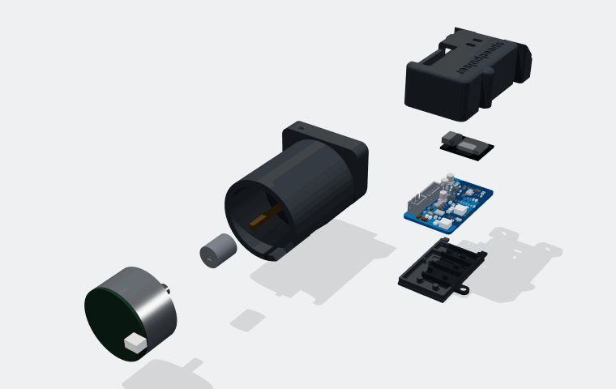
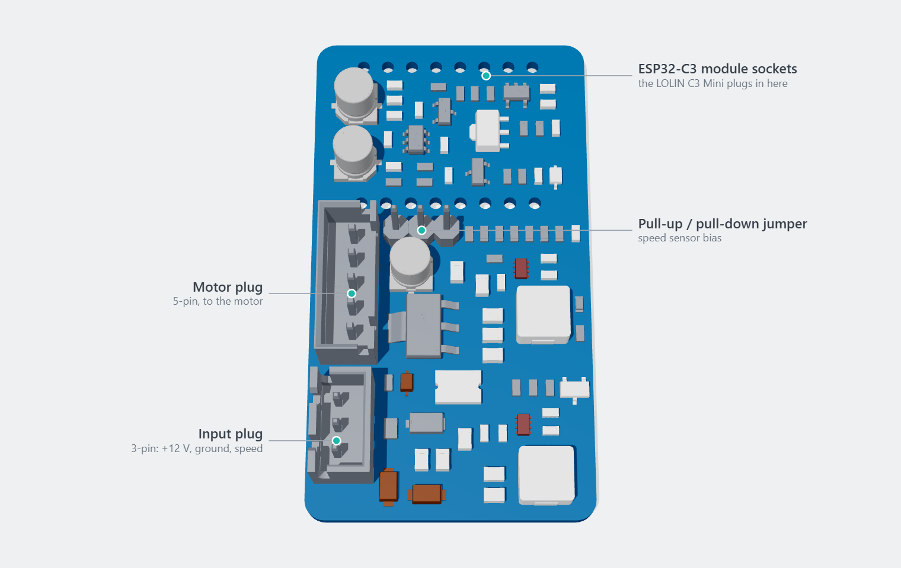
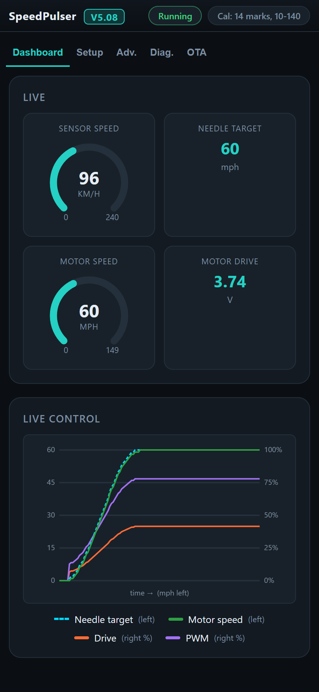
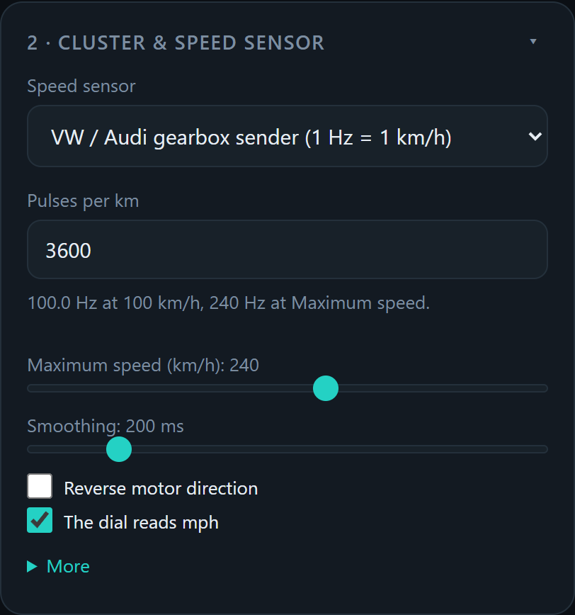
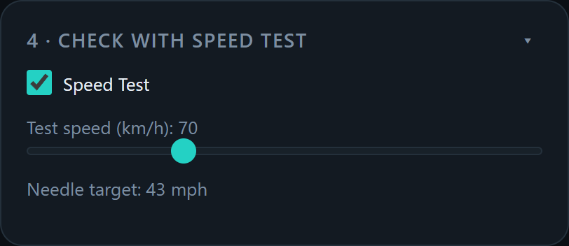
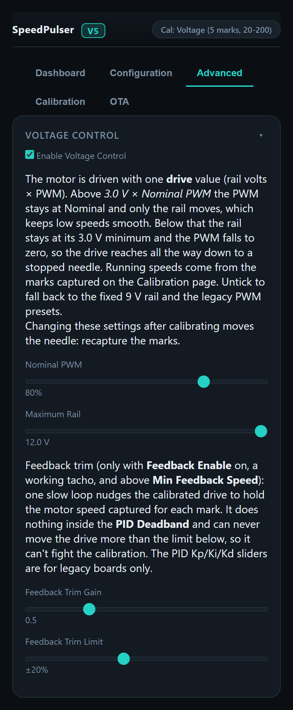
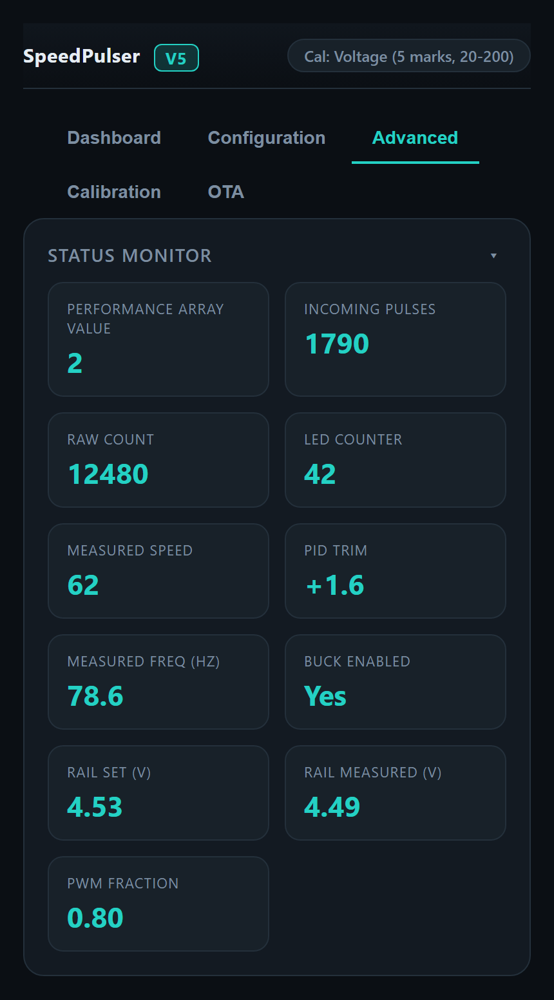

# SpeedPulser

The SpeedPulser brings an OEM analogue speedometer back to life without a mechanical cable. It reads the digital speed pulses from a gearbox hall sensor (or a [Can2Cluster](https://forbes-automotive.com) signal) and drives a small BLDC motor on the back of the speedo with a 10 kHz PWM signal. It is fully open source, set up over WiFi, and calibrated per cluster so the needle reads accurately across the motor's speed range.

It is based on a **LOLIN C3 Mini (ESP32-C3)** and drives a **TY3816B** BLDC motor through a native LEDC hardware PWM channel.


> **Fitting one?** The [Installation & Assembly Manual](docs/INSTALLATION.md) ([PDF](docs/SpeedPulser-Installation-Manual.pdf)) covers every plug and pin, fitting step by step with photos, setup, calibration and troubleshooting.

## Contents

- [How It Goes Together](#how-it-goes-together)
- [The Web Interface](#the-web-interface)
- [Overview](#overview)
  - [Features](#features)
  - [Supported Clusters](#supported-clusters)
  - [Purchase](#purchase)
- [What's in the Box](#whats-in-the-box)
- [Installation](#installation)
  - [Installation Video](#installation-video)
  - [Plugs & Pins](#plugs--pins)
  - [Fitting the Drive Shaft](#fitting-the-drive-shaft)
  - [Fitting to the Cluster](#fitting-to-the-cluster)
- [Setup (WiFi & Web Interface)](#setup-wifi--web-interface)
- [Calibration](#calibration)
- [Feedback & Motor Voltage](#feedback--motor-voltage)
- [Over-the-Air Updates](#over-the-air-updates)
- [How Calibration Works](#how-calibration-works)
- [Power Management](#power-management)
- [Technical Reference](#technical-reference)
- [Building & Flashing](#building--flashing)
- [Disclaimer](#disclaimer)

---

## How It Goes Together



The SpeedPulser is two parts joined by the 5-pin motor lead:

- **The control box** holds the V5 board and the ESP32-C3 module in a printed lid and base, closed by one M3 screw at the lug. The board reads the speed signal, sets the motor's supply voltage (the "rail") and reads the motor's own speed back through its feedback wire, so the needle holds steady across the whole dial.
- **The motor unit** replaces the speedo cable. The TY3816B motor sits in a printed housing that pushes onto the cluster's speedo spigot; a printed coupler on the motor shaft carries a square brass drive shaft into the speedo's drive, exactly where the cable's inner used to go.

---

## The Web Interface

Everything is set up from a phone over the SpeedPulser's own WiFi: no app, no laptop.


---

## Overview

### Features

| Feature | Detail |
|---|---|
| Speed input | 5 V / 12 V square wave (hall sensor or Can2Cluster); any sensor, set by pulses per km, timed pulse by pulse with a glitch filter |
| Motor output | 10 kHz hardware PWM, 12-bit resolution |
| One firmware, every board | A strap on GPIO3 is read at power-up: V4 / V5 boards get voltage control, older PWM-only boards run exactly as before |
| Voltage control *(V4 / V5 board)* | One **drive** value (motor rail volts × PWM) runs the motor, so even the slowest speeds are reachable |
| Drive calibration *(V5 board)* | Capture the top mark by eye, Auto Fill measures the rest from the motor feedback (up to 20 marks, with Restore Previous); running speeds are interpolated between them |
| Board test *(V5 board)* | Motor-rail read-back on GPIO1; **Test Board** steps the rail to 5 / 7.5 / 10 V and checks each one |
| Closed-loop feedback *(V5 board)* | One slow trim on the calibrated drive holds the motor speed measured for each mark |
| Calibration profiles | 18 built-in (VW, Ford, Fiat, Merc, Smiths, Opel, VW Bay) for legacy boards |
| Diagnostics | Live sensor Hz / km/h, needle target, drive, rail, motor feedback and trim; Test Board steps; start-up log |
| Needle sweep | Configurable at power-up |
| Speed offset | Global fixed offset **or** 5-point speed-dependent curve |
| OTA updates | Update from GitHub or by file upload on the OTA tab (car stopped); Home WiFi bridge mode; recovery page if the web UI is ever lost |
| Power management | WiFi off and CPU scaled down after 1 min idle |
| Protection *(V5 board)* | 4 A resettable fuse and reverse-polarity protection on the 12 V input |

### Supported Clusters

On a V5 board you calibrate your own cluster with [Drive Calibration](#drive-calibration-v5-board), so any speedo the motor can drive works. Speedo housings exist for VW, Mercedes, Smiths, Volvo, Ford, Fiat, Jaguar, Porsche, Isuzu, DeLorean and Reliant fittings.

Legacy (PWM-only) boards use built-in presets:

| Cluster | Range | Calibration by |
|---|---|---|
| VW MK1 / MK2 Golf | 120 mph | Martin Springell |
| VW MK1 / MK2 Golf | 120 mph | Forbes Automotive |
| VW MK1 / MK2 Golf | 120 mph | Tara |
| VW MK1 / MK2 Golf | 140 mph | Forbes Automotive |
| VW MK1 / MK2 Golf | 160 mph | Forbes Automotive |
| VW MK1 / MK2 Golf | 300 kph (1.8T) | Forbes Automotive |
| VW Bay VDO | 90 mph | Community |
| Ford Escort | 120 mph (var. 1) | Forbes Automotive |
| Ford Escort | 120 mph (var. 2, Darren) | Community |
| FIAT Uno | 40–160 mph | Forbes Automotive |
| FIAT Uno | 20–110 mph | Forbes Automotive |
| Mercedes W123 | 120 mph | Forbes Automotive |
| Smiths 5/8" | 70 mph | Forbes Automotive |
| Smiths 5/8" | 90 mph | Forbes Automotive |
| Smiths 5/8" | 150 mph | Forbes Automotive |
| Opel Manta A-72 | 200 km/h | Forbes Automotive |

> New models, calibrations and corrections are very welcome: send them in via GitHub or Discord.

### Purchase

Pre-assembled SpeedPulser units are available here: [SpeedPulser at Forbes Automotive](https://forbes-automotive.com/products/speedpulser)

---

## What's in the Box

| Part | Notes |
|---|---|
| Control box | The V5 board and ESP32-C3 module in a printed lid and base, held by one M3 screw at the lug |
| Motor in its speedo housing | Coupler pre-fitted to the motor shaft; the motor is held in the housing by 3 screws |
| Brass drive shaft | Square brass rod. **Not fitted when shipped.** Supplied long: trim to suit your cluster |
| Securing pins | Two, for housings that have the cross holes in the flange |
| Spare coupler | Couplers are 3D printed |
| Input lead | 3-pin: black +12 V, white ground, red speed signal |

**The motor** is a TY3816B 12 V outrunner BLDC motor with its own driver board on the back: 37.4 mm can, 6 mm D shaft. Its leads are red (+), white (feedback), yellow (direction), black (ground) and blue (PWM).

---

## Installation

The [Installation & Assembly Manual](docs/INSTALLATION.md) ([PDF](docs/SpeedPulser-Installation-Manual.pdf)) has the full version of everything below, with a photo for every fitting step.

### Installation Video

[](/Images/installation-video.mp4)

About a minute, start to finish: stripping the motor out of its housing (the drive shaft isn't fitted when shipped), fitting and lining up the shaft, refitting the motor, securing it on the cluster, then setup and calibration.

### Plugs & Pins



**Input**: the 3-pin plug takes 12 V power and the speed signal.

| Pin | Signal | Lead | Notes |
|-----|--------|------|-------|
| 1 | +12 V | Black | Ignition-switched 12 V. Pin 1 is nearest the board edge |
| 2 | Ground | White | Chassis / cluster ground |
| 3 | Speed signal | Red | 5 V or 12 V square wave from a hall sensor or Can2Cluster |

> **Black is +12 V and red is the speed signal** on the supplied lead. Go by the pin number and check with a meter before you power up.

> **Fuse:** the V5 board has its own 4 A resettable fuse on the 12 V input, so an inline fuse isn't needed. On an older board, fuse the 12 V feed (2 A or 3 A).

**Motor**: the 5-pin plug, made up and plugged in when shipped.

| Pin | Signal | Motor lead | Notes |
|-----|--------|------------|-------|
| 1 | Motor + | Red | The motor rail the firmware sets (Minimum to Maximum rail, up to 12 V) |
| 2 | Feedback (FG) | White | 5 pulses per motor revolution, read on GPIO4 |
| 3 | Direction | Yellow | Low = normal; **Reverse motor direction** in setup flips it |
| 4 | Ground | Black | Motor ground |
| 5 | PWM | Blue | 10 kHz PWM from the ESP32 (via an NPN level shifter) |

**Pull-up / pull-down jumper**: hall sensors need either a pull-up or a pull-down on the signal. Pins 1 and 2 = pull-up (the default, right for VW / Audi senders); pins 2 and 3 = pull-down; removed = none (sensors with their own resistor, and Can2Cluster). If the SpeedPulser sees no pulses, try the other position first.

### Fitting the Drive Shaft

The drive shaft is not fitted when the unit ships, so the motor comes out of its housing once:


1. Undo the 3 screws and slide the motor out of the speedo housing.
2. Push the brass drive shaft into the square in the coupler, lined up straight. It's a tight fit: a few light taps will seat it.
3. Spin the motor by hand: the shaft must run true. Couplers are 3D printed, so slight misalignment is normal; gentle heat (≤ 100 °C) on the coupler lets you straighten it. If vibration ever loosens the coupler, a drop of superglue fixes it for good. Make sure it runs true before the glue sets.
4. Refit the motor with its wires out through the slot in the housing, and refit the 3 screws.
5. Check the shaft length against the cluster: it must engage the speedo drive but not bottom out and stop the housing seating fully. Trim it to suit, typically flush with the nose of the housing.

A spare coupler is in the box.

### Fitting to the Cluster

Push the housing straight on to the cluster's speedo spigot until it seats against the speedo plate, turning it slightly if the shaft needs to find the square in the speedo drive. Where your housing has them, push the two securing pins through the cross holes in its flange: they sit either side of the spigot and lock into its groove. Then check:

- the drive shaft engages cleanly
- the motor spins freely by hand
- the housing seats fully

Take your time here: good fitment keeps noise down and makes the coupler last. Every motor / housing / cluster pairing wears in slightly differently, so check the top of the dial with Speed Test after a few hours and re-capture the top mark if needed.

---

## Setup (WiFi & Web Interface)

Connect to the **`SpeedPulser`** WiFi access point (open network) and open **`192.168.1.1`** or **`speedpulser.local`** in a browser.

The interface is a single-page app served from the ESP32's LittleFS partition, in Forbes Automotive's dark theme. Settings apply straight away and are saved every 2 seconds. Every value shown is the one the unit actually kept: a value it limits or refuses snaps back. The header shows the firmware version, what the unit is doing (**Running / Speed Test / Calibration Mode**) and what drives the needle (**Cal:**). Current firmware version: **5.10**.

Five tabs, in the order a unit is set up:

| Tab | What's on it |
|---|---|
| **Dashboard** | Live sensor speed (km/h), needle target (dial units), motor speed, motor drive, and a chart: the live control trace (V5 board) or the active calibration curve (legacy board) |
| **Setup** | Six numbered cards, top to bottom: **1 Board** (type; Test Board on a V5 board), **2 Cluster & Speed Sensor**, **3 Calibrate**, **4 Check with Speed Test**, **5 Fine-tune** (speed offset), **6 Needle Sweep** |
| **Advanced** | Feedback and Motor Voltage (V5 board), Export / Import, Display Options (dial gauges, per browser) |
| **Diagnostics** | Live values (sensor Hz and km/h, offset, needle target, motor duty, drive, rail, motor feedback, trim), the Test Board steps, the Start-up Log |
| **OTA** | Firmware and web UI updates (see [Over-the-Air Updates](#over-the-air-updates)) |

Cards open and close by tapping their heading, and remember that per browser. Board-specific cards only show on the board they belong to.

<p align="center">
  
  
</p>

### Setup, step by step

**1 · Board**: the board type, read from the GPIO3 strap at power-up. On a **V5 board** run **Test Board** once (12 V supply connected): it stops the motor, steps the rail to 5, 7.5 and 10 V and reads each back. That proves the voltage injection and the rail sense, and stores this board's own voltage line.

**2 · Cluster & Speed Sensor**

| Setting | What it does |
|---|---|
| The dial reads mph | The sensor speed (km/h) is converted to mph for the needle. Drive marks are captured in the dial's unit, so changing it on a calibrated V5 board asks first |
| Speed sensor / Pulses per km | How many pulses the sensor gives per km. VW / Audi gearbox senders: **3600** (1 Hz = 1 km/h). 4,000 / 8,000 / 16,000 pulses-per-mile sensors are in the list; anything else: pulses per mile ÷ 1.609. The card shows the Hz this means at 100 km/h and at Maximum speed |
| Maximum speed (km/h) | The fastest the needle is ever driven; a faster input holds here |
| Smoothing (ms) | The speed is averaged over at least this long: longer = steadier, shorter = quicker. Default 200 ms |
| Reverse motor direction | Flips the motor (GPIO10 HIGH). Only changes with the motor stopped. Unticked is normal on every board |

**3 · Calibrate**: *V5 board*: **Drive Calibration** with **Auto Fill** (see [Calibration](#calibration)). *Legacy board*: pick the cluster **preset**, or build your own with the **Calibration Builder** and pick **★ Custom**.

**4 · Check with Speed Test**: the needle follows the slider (km/h, through the same offset and mph conversion as the sensor) instead of the sensor; the card shows the needle target. Speed Test and Calibration Mode can't both be on: switching one on switches the other off. Speed Test is never saved, so the unit always starts in normal running.

**5 · Fine-tune (Speed Offset)**: a fixed offset (−50…+50 km/h), or a different offset at 25 / 75 / 125 / 175 / 225 km/h (±20 each) with straight lines between them, so the needle never jumps as the speed changes. Applied while moving only.

**6 · Needle Sweep**: sweep at power-up, its pace (ms per dial km/h or mph), and a Test Sweep button (only with the car stopped). The sweep moves the needle evenly from the lowest to the highest calibrated speed. It ramps the speed, not the drive, and looks up the drive for each step through the calibration, so the motor's uneven response doesn't show. It slows to a stop at the top, waits there until the motor has arrived (motor feedback) or 0.4 s (no feedback), and comes back the same way. No calibration, no sweep.

<p align="center">
  
  
</p>

---

## Calibration

### Drive Calibration *(V5 board)*

1. Tick **Calibration Mode**. The motor starts stopped.
2. Raise the **Drive** (the −0.5 … +0.5 buttons; the bar under them only shows the drive, and the unit raises it at most 0.5 V per press) until the needle sits exactly on your **top mark**: the highest speed the needle should ever show (nothing runs past it). Wait for **Steady**, type the speed and press **Capture Mark**. A low mark by eye too (e.g. 40) makes the low end closer.
3. Press **Auto Fill** (needs the motor feedback). The motor works through the dial on its own, lowest speed first, in 1-2 minutes. It keeps every eye mark's speed and feedback Hz, re-measures its drive, and adds **auto** marks (10, 20, 30, 40, then every 10 to the top mark, wider if the 20 marks run out) on the straight line through the eye marks, finding the drive that holds each mark's feedback Hz. It never runs faster than the top mark or with more drive than 1.25 × the top mark's, and stops the motor if anything looks wrong. Stopping it (or a failure) puts the old table back, and after a run **Restore Previous** swaps back (and again). A mark can be switched between eye and auto by tapping its pill.
4. Check with Speed Test. If a speed is off, put the needle on it and capture it: a mark set by eye always wins and replaces the auto marks that disagree with it.

Until the first mark is captured the motor doesn't move outside Calibration Mode, so an uncalibrated unit can't drive a speedo past the top of its dial. Marks can only be changed, cleared, restored or imported in Calibration Mode, so nothing jumps the needle while driving.

Why so few eye marks are needed: the dial (feedback Hz → needle) is a straight line only a person can see, while the motor (drive → Hz) bends at the bottom but the motor feedback measures it. On the bench, ten marks captured by eye, 40-193 km/h, all sat within 0.9 km/h of one line.

<p align="center">
  
  
</p>

### Export / Import *(Advanced tab)*

**Export Calibration** saves the drive marks (V5 board, with the drive settings they were captured with) or the Calibration Builder points (legacy board). **Export as Firmware Preset** writes a paste-ready `motorPerformanceN[]` table. Each file says which kind it is, and **Import File** loads whichever kind it is. The whole file is checked first, and nothing changes if it doesn't fit.

### Legacy boards (V2 to V4)

Older boards without voltage control run the same firmware. They use a built-in **preset** or the **Calibration Builder**: tick Calibration Mode, go to maximum duty and set the board's trimmer so the needle reads the cluster's top speed, then step the duty with −50 … +50, capturing a speed at each mark, and **Save & Use** to run it as **★ Custom**. With ★ Custom running and Calibration Mode ticked, a point can be held and dragged up or down on the Dashboard chart to fine-tune it. Expect to revisit the trimmer once after a few hours of running as the motor and coupler bed in.

---

## Feedback & Motor Voltage

*V5 board only.* With **Hold the calibrated motor speed** on (Advanced → Feedback), one slow loop nudges the calibrated drive to hold the motor speed captured for each mark, against load and temperature drift. It works above **Off below** (dial units) and outside the **Deadband**, and can never move the drive more than **Trim limit**, nor more than 5 % past the top mark; **Trim gain** sets how quickly it acts. The trim compares the measured motor speed with where the motor *should* be by now (a new target is followed with the motor's own ~0.35 s lag), so a speed change is left to the calibration and doesn't overshoot. Bench-tuned defaults: on, gain **2.0**, limit **±40 %**, deadband **0.3 Hz**, off below **8**; **Reset Feedback Defaults** loads them. On the bench this held 10-160 km/h within about 1 % and recovered a sudden 27 % slow-down at 20 km/h in about 1.5 s.

**Motor feedback measurement.** The motor gives 5 feedback (FG) pulses per revolution. The firmware times the pulses and averages whole revolutions (which cancels the uneven pole spacing), with a 1 ms filter for line noise, so the reading holds steady down to the motor's slowest speed (~6 Hz).

**Motor Voltage** (Advanced): the motor is driven with one **drive** value, rail volts × PWM. At the low end the rail holds at **Minimum rail** (default 4.8 V: the motor's driver runs smoothly and restarts reliably from about 4.75 V) and the PWM falls to zero; above Minimum rail × **Nominal PWM** the PWM stays at Nominal and the rail rises, up to **Maximum rail**. They change in Calibration Mode only, and moving them after calibrating moves the needle: run Auto Fill again. Maximum rail defaults to 8 V on a new unit (up to 12 V): raise it if the needle can't reach the top of a fast dial.

<p align="center">
  
  
  
</p>

---

## Over-the-Air Updates

Everything happens on the **OTA** tab, only with the car stopped (an update restarts the unit). USB is only needed for the very first install, or if the web interface is ever lost.

- **Update from GitHub**: press **Check for updates**. The page reads the release list from [`Forbes-Automotive/speedPulser`](https://github.com/Forbes-Automotive/speedPulser) (`Releases/releases.json` plus the `V…` folders) and shows *Installed* vs. *Latest* (older and beta releases sit behind a tick-box, for rolling back). It then installs the selected version in six tracked steps: download the web UI and the firmware, flash the web UI, verify it, flash the firmware, reboot. Nothing is flashed until both files are in. The browser needs internet *while it can still reach the controller*: join the controller to your router in the **Home WiFi (Bridge Mode)** card, put the phone on the same network and open the address the card shows (`http://speedpulser.local/` works there too). On the controller's own access point alone, most phones drop mobile data.
- **Home WiFi (Bridge Mode)**: the controller joins a home or garage network as a station alongside its own access point. Scan or type the network name, save, and once it shows *Connected* the controller is reachable from that network as well. It tries hard for 20 s after boot, then once every 5 minutes, so a saved network can't disturb the access point when the car is parked away from home.
- **Update from Files**: no internet needed: download `littlefs.bin` and `firmware.bin` from the newest `Releases/V…/` folder and upload them here, **Filesystem** (web UI) first, then **Firmware**. The device reboots after the firmware.

Every upload is size-checked, and a filesystem image is verified by mounting it before the device reports success; a failed filesystem upload is wiped rather than left half-written. If the web interface is ever missing (a filesystem update that stopped part-way), the controller serves a **recovery page** at its address with the same two uploads and partition diagnostics, so it is never a USB job.

<p align="center">
  
</p>

---

## How Calibration Works

### The Speed Input

```
Speed sensor pulse (GPIO5, falling edge)
    │
    ▼  speedInputPulse()  — interrupt
    Keeps the time of the last 64 pulses. A pulse closer to the last one than half a
    period at Maximum speed is noise (ignition EMI) and is dropped.
    │
    ▼  every 100 ms (control task)
    frequency = pulses ÷ time, over at least the Smoothing time (or the 64 pulses).
    No pulse for a while: the reading falls smoothly (it can't be faster than 1.5 ÷
    time since the last pulse); 0 after 1.5 s.
    speed (km/h) = Hz × 3600 ÷ pulses per km, held at Maximum speed
    │
    ▼  toNeedleTarget()
    + offset (global, or the 5-point curve, interpolated) → × 0.621371 if the dial
    reads mph → rounded once → needle target (dial units)
    │
    ▼  V5 board:     drive calibration (+ feedback trim) → rail + PWM
       legacy board: preset / custom table → 12-bit PWM duty (GPIO2, 10 kHz)
```

A faster sensor just needs its pulses per km: the glitch filter follows it (e.g. 16,000 pulses per mile is ~550 Hz at 200 km/h, filter 0.9 ms). Settings from older firmware carry over: the old Max Hall Frequency / Max Speed pair becomes pulses per km = 3600 × Hz ÷ km/h.

### The Legacy Calibration Array

Each preset is a **385-entry `uint16_t` array** in flash (`PROGMEM`): the **index** is a 10-bit PWM duty (0–384) and the **value** is the speed the needle shows at that duty. Leading values are `0` (the motor's dead band). `findClosestMatch()` finds the duty whose speed is nearest the target; the firmware then interpolates towards the neighbouring entry for a 12-bit duty.

---

## Power Management

The firmware includes a **universal reduced-power code block** (`power_manager`, also used in SpeedPulser Pro, Can2Cluster and other projects) that kicks in 1 minute after the last WiFi client disconnects. This cuts the current through the on-board regulator, directly reducing its heat: important for long ignition-on times.

| Action | Saving |
|---|---|
| WiFi radio off | ~80–120 mA average (single biggest saving) |
| CPU: 160 MHz → 80 MHz | Moderate reduction in active current |
| Bluetooth controller released at boot | ~60 KB RAM freed; small idle current saving |
| WiFi modem-sleep while clients are connected | Minor saving without losing connectivity |
| Reduced WiFi TX power | Adequate for in-car range; further small saving |

**Waking back up:** as soon as a device reconnects to the WiFi AP, full power comes back automatically: the radio comes up, the CPU returns to 160 MHz and the web server resumes. A power cycle (ignition off / on) also restores WiFi.

---

## Technical Reference

### Pin Assignments (LOLIN C3 Mini)

| GPIO | Function |
|---|---|
| 1 | Motor rail read-back, V_MOT_SENSE (V5 board; 39k / 10k divider) |
| 2 | Motor PWM output (LEDC 12-bit, stepped to 5 V via NPN transistor) |
| 3 | Board strap, read at power-up (1k to GND = voltage board, open = legacy PWM-only board) |
| 4 | Motor feedback (FG) input (V5 board; falling-edge interrupt, timed pulse by pulse) |
| 5 | Speed pulse input (falling-edge interrupt) |
| 6 | V_ADJ: PWM "DAC" into the motor buck converter's feedback (V4 / V5 board; higher V_ADJ = lower rail) |
| 7 | EN_ADJ: motor buck converter enable (V4 / V5 board) |
| 8 | Onboard LED (blinks to confirm incoming pulses) |
| 10 | Motor direction (LOW = normal, HIGH = reversed) |

### PWM Parameters

| Parameter | Value |
|---|---|
| Frequency | 10 kHz |
| Resolution | 12-bit (0–4095) |
| Driver | Native ESP-IDF `ledc_set_duty` / `ledc_update_duty` |

### FreeRTOS Tasks

| Task | Core | Period |
|---|---|---|
| `speedControl` | 0 | 100 ms (speed input, motor, motor feedback, Auto Fill) |
| `settingsSave` | 0 | 2 000 ms (NVS only writes values that changed) |
| `powerManagerTask` | 0 | 5 000 ms check interval |

### PlatformIO Dependencies

| Library | Purpose |
|---|---|
| `mathieucarbou/ESPAsyncWebServer` | Async web server (ESP-IDF 5.x compatible fork) |
| `mathieucarbou/AsyncTCP` | Underlying TCP for AsyncWebServer |
| `bblanchon/ArduinoJson` | JSON serialisation for REST API |

Platform: `pioarduino/platform-espressif32` (Arduino-ESP32 3.x / ESP-IDF 5.x). The version history is in `include/speedPulser_ver.h`.

---

## Building & Flashing

1. Open the project folder in VS Code with the PlatformIO extension installed.
2. Confirm `env:lolin_c3_mini` is selected in `platformio.ini`.
3. **Build Filesystem Image** (PlatformIO sidebar): packages the web UI files from `data/` into a LittleFS image.
4. **Upload Filesystem Image**: flashes the web UI to the LittleFS partition.
5. **Build & Upload**: flashes the main firmware.
6. Open the Serial Monitor at 115 200 baud to confirm the start-up messages.

> Serial debug output is controlled by `-D enableDebug` in `platformio.ini` (0 for releases; 1 adds tagged debug output and a 2 s wait for a USB host at boot).

---

## Disclaimer

The SpeedPulser drives an analogue speedometer for display purposes. The reading depends on the sensor, tyre size and calibration, so always treat it as approximate. Forbes Automotive accepts no responsibility for incorrect speed readings or any speed-related incident arising from its use. Intended for off-road and motorsport use.
