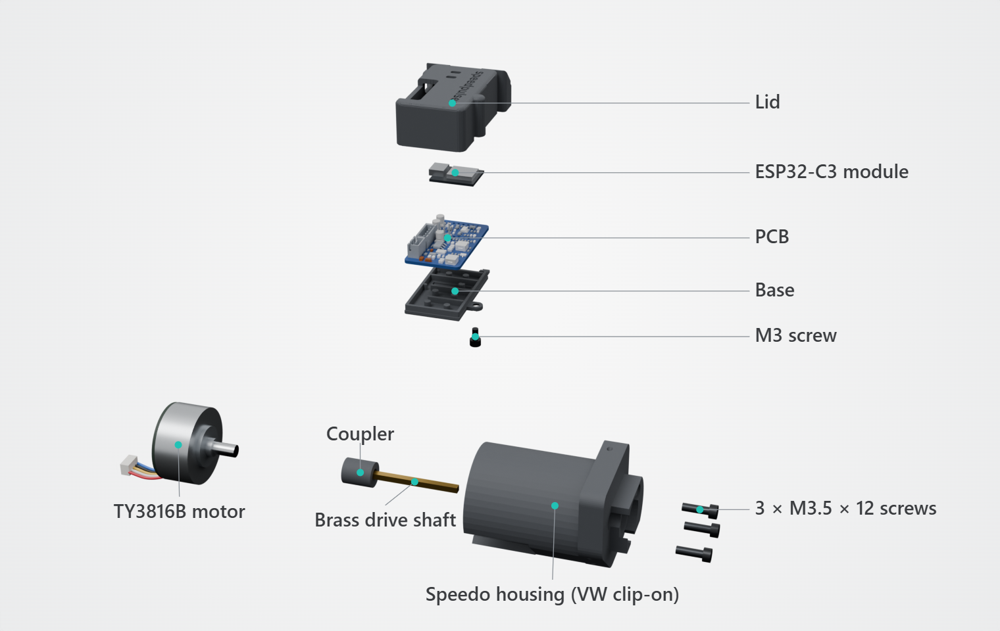
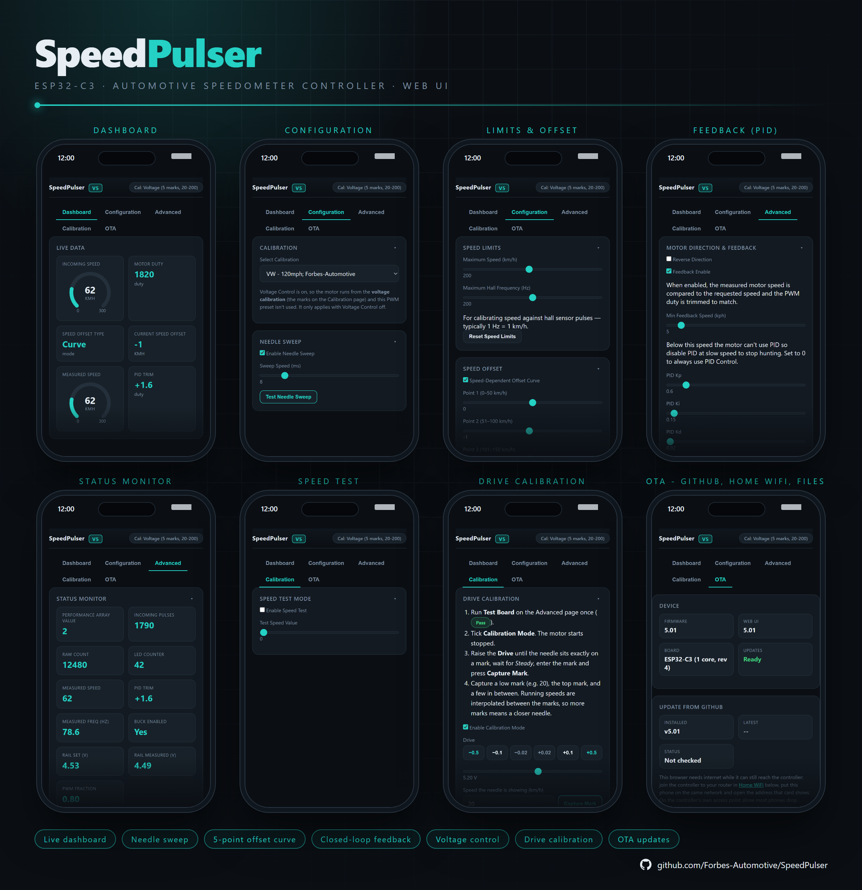
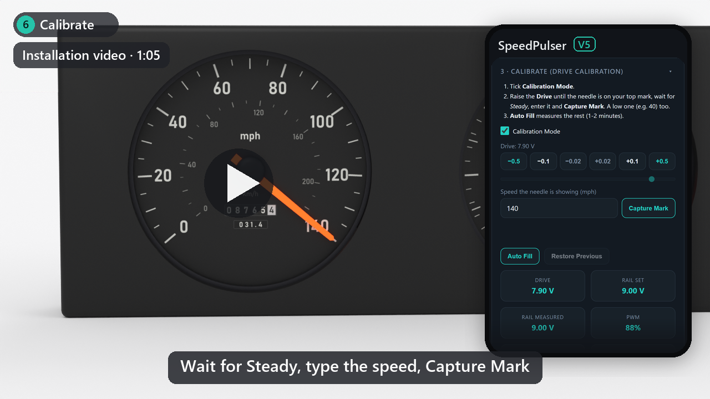
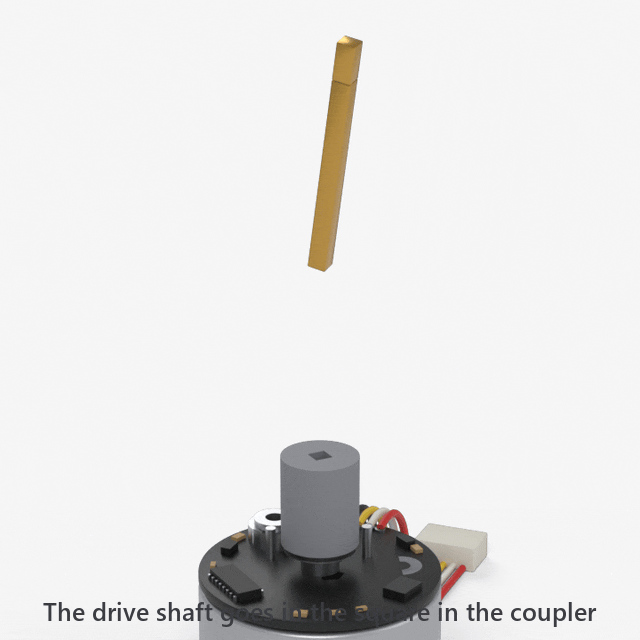
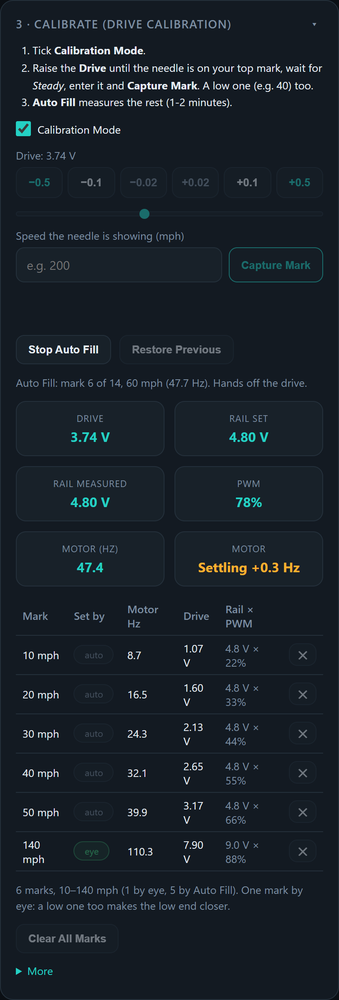
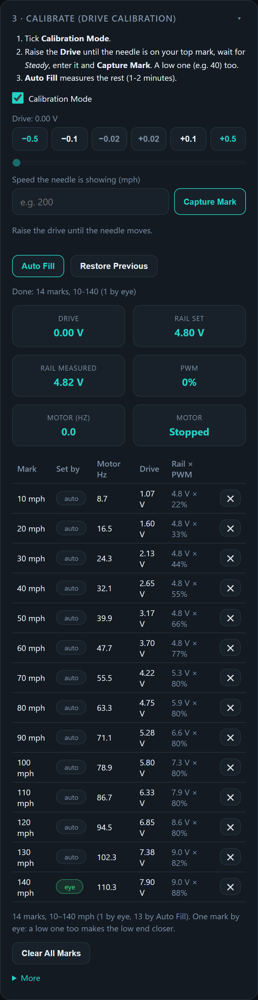
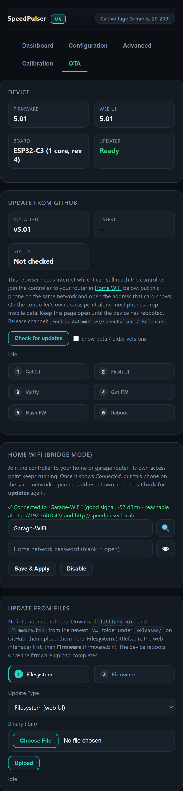

# SpeedPulser

The SpeedPulser drives an analogue speedometer without a cable. It reads the speed pulses from a gearbox hall sensor (or a [Can2Cluster](https://forbes-automotive.com)) and spins a small motor on the back of the speedo at the right speed for the needle. It's open source, set up from your phone over WiFi, and calibrated to your own cluster.

Inside: a **LOLIN C3 Mini (ESP32-C3)** driving a **TY3816B** BLDC motor.

> **Fitting one?** The [Installation & Assembly Manual](docs/INSTALLATION.md) ([PDF](docs/SpeedPulser-Installation-Manual.pdf)) covers every plug and pin, fitting step by step with photos, setup, calibration and troubleshooting.

## Contents

- [How It Goes Together](#how-it-goes-together)
- [The Web Interface](#the-web-interface)
- [Overview](#overview)
  - [Features](#features)
  - [Supported Clusters](#supported-clusters)
  - [Purchase](#purchase)
- [What's in the Box](#whats-in-the-box)
- [Installation](#installation)
  - [Installation Video](#installation-video)
  - [Plugs & Pins](#plugs--pins)
  - [Fitting the Drive Shaft](#fitting-the-drive-shaft)
  - [Fitting to the Cluster](#fitting-to-the-cluster)
- [Setup (WiFi & Web Interface)](#setup-wifi--web-interface)
- [Calibration](#calibration)
- [Feedback & Motor Voltage](#feedback--motor-voltage)
- [Over-the-Air Updates](#over-the-air-updates)
- [Power Management](#power-management)
- [Technical Reference](#technical-reference)
- [Building & Flashing](#building--flashing)
- [Disclaimer](#disclaimer)

---

## How It Goes Together

Two parts, joined by the 5-pin motor lead:

- **Control box:** the board and ESP32-C3 module in a printed lid and base, held by one M3 screw. It reads the speed signal and drives the motor, using the motor's own feedback to keep the needle steady.
- **Motor unit:** the motor in a printed housing that pushes onto the speedo spigot. A coupler on the motor shaft carries a square brass shaft into the speedo, where the cable used to go.

---

## The Web Interface

Set up from your phone over the SpeedPulser's own WiFi: no app or laptop needed.

---

## Overview

### Features

| Feature | Detail |
|---|---|
| Speed input | 5 V or 12 V square wave from any hall sensor or a Can2Cluster, set by pulses per km |
| Calibration *(V5 board)* | Set the top mark by eye; **Auto Fill** measures the rest from the motor's feedback |
| Feedback *(V5 board)* | Holds the motor at the calibrated speed against load and temperature |
| Board test *(V5 board)* | **Test Board** checks the motor supply at 5, 7.5 and 10 V |
| Legacy boards | Same firmware; 18 built-in presets or your own Calibration Builder table |
| Fine-tuning | Fixed speed offset, or a 5-point curve across the dial; needle sweep at power-up |
| Diagnostics | Live speed, sensor Hz, motor drive, rail and feedback; start-up log |
| Updates | Over WiFi from GitHub or by file upload; recovery page if the web UI is ever lost |
| Power saving | WiFi off and CPU slowed after 1 minute idle |
| Protection *(V5 board)* | 4 A resettable fuse and reverse-polarity protection on the 12 V input |

### Supported Clusters

A V5 board is calibrated to your own cluster, so any speedo the motor can drive works. Speedo housings exist for VW, Mercedes, Smiths, Volvo, Ford, Fiat, Jaguar, Porsche, Isuzu, DeLorean and Reliant fittings.

Built-in presets for legacy boards:

| Cluster | Range | Calibration by |
|---|---|---|
| VW MK1 / MK2 Golf | 120 mph | Martin Springell |
| VW MK1 / MK2 Golf | 120 mph | Forbes Automotive |
| VW MK1 / MK2 Golf | 120 mph | Tara |
| VW MK1 / MK2 Golf | 140 mph | Forbes Automotive |
| VW MK1 / MK2 Golf | 160 mph | Forbes Automotive |
| VW MK1 / MK2 Golf | 300 kph (1.8T) | Forbes Automotive |
| VW Bay VDO | 90 mph | Community |
| Ford Escort | 120 mph (var. 1) | Forbes Automotive |
| Ford Escort | 120 mph (var. 2, Darren) | Community |
| FIAT Uno | 40–160 mph | Forbes Automotive |
| FIAT Uno | 20–110 mph | Forbes Automotive |
| Mercedes W123 | 120 mph | Forbes Automotive |
| Smiths 5/8" | 70 mph | Forbes Automotive |
| Smiths 5/8" | 90 mph | Forbes Automotive |
| Smiths 5/8" | 150 mph | Forbes Automotive |
| Opel Manta A-72 | 200 km/h | Forbes Automotive |

> New models, calibrations and corrections are very welcome: send them in via GitHub or Discord.

### Purchase

Pre-assembled SpeedPulser units are available here: [SpeedPulser at Forbes Automotive](https://forbes-automotive.com/products/speedpulser)

---

## What's in the Box

| Part | Notes |
|---|---|
| Control box | The V5 board and ESP32-C3 module in a printed lid and base, held by one M3 screw at the lug |
| Motor in its speedo housing | Coupler pre-fitted to the motor shaft; the motor is held in the housing by 3 screws |
| Brass drive shaft | Square brass rod. **Not fitted when shipped.** Supplied long: trim to suit your cluster |
| Securing pins | Two, for housings that have the cross holes in the flange |
| Spare coupler | Couplers are 3D printed |
| Input lead | 3-pin: black +12 V, white ground, red speed signal |

**The motor** is a TY3816B 12 V BLDC outrunner with its own driver board (37.4 mm can, 6 mm D shaft).

---

## Installation

The [Installation & Assembly Manual](docs/INSTALLATION.md) ([PDF](docs/SpeedPulser-Installation-Manual.pdf)) has the full version, with a photo for every step.

### Installation Video

About a minute: fitting the drive shaft, fitting to the cluster, then setup and calibration.

### Plugs & Pins

| Plug | Pin | Signal | Connect to |
|---|---|---|---|
| Input (3-pin) | 1 | +12 V | Ignition-switched 12 V |
| | 2 | Ground | Chassis or cluster ground |
| | 3 | Speed signal | Hall sensor or Can2Cluster (5 V or 12 V square wave) |
| Motor (5-pin) | 1 to 5 | Motor +, feedback, direction, ground, PWM | The motor lead (fitted when shipped) |

> **Go by the pin number, not the colour.** On the supplied input lead black is +12 V and red is the speed signal. Check with a meter before you power up.

The V5 board has its own 4 A resettable fuse, so no inline fuse is needed (fuse an older board's feed at 2 A or 3 A). The **speed sensor jumper** sets the input's bias: pins 1-2 pull-up (default, VW / Audi senders), 2-3 pull-down, removed for none. No pulses? Try the other position.

### Fitting the Drive Shaft

The drive shaft isn't fitted when shipped, so the motor comes out of its housing once:

1. Undo the 3 screws and slide the motor out of the speedo housing.
2. Push the brass drive shaft into the square in the coupler, lined up straight. It's a tight fit: a few light taps will seat it.
3. Spin it by hand: the shaft must run true. If it doesn't, gently warm the coupler (no more than 100 °C) and straighten it. A loose coupler can be fixed with a drop of superglue once it runs true.
4. Refit the motor with its wires out through the slot in the housing, and refit the 3 screws.
5. Trim the shaft so it engages the speedo drive without stopping the housing seating fully (usually flush with the housing's nose).

### Fitting to the Cluster

Push the housing straight onto the speedo spigot until it seats, turning it slightly so the shaft finds the square. Fit the two securing pins through the flange where your housing has them. Check the motor turns freely by hand: a good fit keeps it quiet and makes the coupler last. After a few hours' use, check the top of the dial with Speed Test and re-capture the top mark if needed.

---

## Setup (WiFi & Web Interface)

Connect to the **`SpeedPulser`** WiFi access point (open network) and open **`192.168.1.1`** or **`speedpulser.local`** in a browser.

Settings apply straight away and save automatically. The header shows the firmware version (currently **5.10**) and what the unit is doing. Five tabs:

| Tab | What's on it |
|---|---|
| **Dashboard** | Live speed, needle target, motor speed and drive, with a live chart |
| **Setup** | Six numbered cards, worked through in order (below) |
| **Advanced** | Feedback, motor voltage, export / import |
| **Diagnostics** | Every live value, the Test Board steps and the start-up log |
| **OTA** | Firmware updates (see [Over-the-Air Updates](#over-the-air-updates)) |

  
  

### Setup, step by step

1. **Board**: shows the board type. On a V5 board, press **Test Board** once with 12 V connected.
2. **Cluster & Speed Sensor**: tick **The dial reads mph** for an mph speedo, pick your sensor (VW / Audi: **3600** pulses per km) and set **Maximum speed**. Needle going the wrong way? Tick **Reverse motor direction**.
3. **Calibrate**: V5 board: [Drive Calibration](#calibration). Legacy board: pick a preset or build your own.
4. **Check with Speed Test**: move the slider and check the needle against the dial.
5. **Fine-tune**: a fixed speed offset, or a 5-point curve across the dial.
6. **Needle Sweep**: optional sweep of the needle at power-up.

  
  

---

## Calibration

### Drive Calibration *(V5 board)*

1. Tick **Calibration Mode**.
2. Raise the **Drive** with the + buttons until the needle sits on your **top mark** (the highest speed it should ever show). Wait for **Steady**, type the speed and press **Capture Mark**.
3. Press **Auto Fill**. The motor works through the dial on its own and adds a mark every 10 (1-2 minutes). **Restore Previous** undoes it.
4. Check with Speed Test. If any speed is off, put the needle on it and capture it: a mark set by eye always wins.

Until the first mark is captured the motor won't move outside Calibration Mode, so an uncalibrated unit can't over-drive a speedo.

  
  

### Export / Import *(Advanced tab)*

**Export Calibration** saves your calibration to your phone; **Import File** loads it back, on this unit or a replacement.

### Legacy boards (V2 to V4)

Older boards run the same firmware with a built-in **preset**, or your own table from the **Calibration Builder**: set the board's trimmer so maximum duty reads the dial's top speed, then capture a speed at each mark and **Save & Use**. Revisit the trimmer after a few hours as the motor beds in.

---

## Feedback & Motor Voltage

*V5 board only.* **Feedback** (Advanced, on by default) gently trims the motor drive to hold the speed calibrated for each mark, against load and temperature. On the bench it holds 10-160 km/h within about 1 %. **Reset Feedback Defaults** restores the tuned settings.

**Motor Voltage** (Advanced): the motor runs from a rail between **Minimum rail** (4.8 V) and **Maximum rail** (8 V by default, up to 12 V). If the needle can't reach the top of a fast dial, raise Maximum rail, then run Auto Fill again.

  
  
  

---

## Over-the-Air Updates

Everything happens on the **OTA** tab, only with the car stopped (an update restarts the unit). USB is only needed for the very first install, or if the web interface is ever lost.

- **Update from GitHub**: join the SpeedPulser to your home WiFi in the **Home WiFi (Bridge Mode)** card, put your phone on the same network, open the address shown and press **Check for updates**. Older versions are there too, for rolling back.
- **Update from Files**: no internet needed. Download `littlefs.bin` and `firmware.bin` from the newest `Releases/V…` folder and upload them, **Filesystem** first, then **Firmware**.

Your settings and calibration are kept. If an update is ever interrupted, the SpeedPulser serves a recovery page at its usual address, so it never needs USB.

  

---

## Power Management

One minute after the last phone disconnects, the SpeedPulser turns its WiFi off and slows the CPU, saving about 100 mA and keeping it cool. Turn the ignition off and on to bring WiFi back.

---

## Technical Reference

### Pin Assignments (LOLIN C3 Mini)

| GPIO | Function |
|---|---|
| 1 | Motor rail read-back, V_MOT_SENSE (V5 board; 39k / 10k divider) |
| 2 | Motor PWM output (LEDC 12-bit, stepped to 5 V via NPN transistor) |
| 3 | Board strap, read at power-up (1k to GND = voltage board, open = legacy PWM-only board) |
| 4 | Motor feedback (FG) input (V5 board; falling-edge interrupt, timed pulse by pulse) |
| 5 | Speed pulse input (falling-edge interrupt) |
| 6 | V_ADJ: PWM "DAC" into the motor buck converter's feedback (V4 / V5 board; higher V_ADJ = lower rail) |
| 7 | EN_ADJ: motor buck converter enable (V4 / V5 board) |
| 8 | Onboard LED (blinks to confirm incoming pulses) |
| 10 | Motor direction (LOW = normal, HIGH = reversed) |

### PWM Parameters

| Parameter | Value |
|---|---|
| Frequency | 10 kHz |
| Resolution | 12-bit (0–4095) |
| Driver | Native ESP-IDF `ledc_set_duty` / `ledc_update_duty` |

### FreeRTOS Tasks

| Task | Core | Period |
|---|---|---|
| `speedControl` | 0 | 100 ms (speed input, motor, motor feedback, Auto Fill) |
| `settingsSave` | 0 | 2 000 ms (NVS only writes values that changed) |
| `powerManagerTask` | 0 | 5 000 ms check interval |

### PlatformIO Dependencies

| Library | Purpose |
|---|---|
| `mathieucarbou/ESPAsyncWebServer` | Async web server (ESP-IDF 5.x compatible fork) |
| `mathieucarbou/AsyncTCP` | Underlying TCP for AsyncWebServer |
| `bblanchon/ArduinoJson` | JSON serialisation for REST API |

Platform: `pioarduino/platform-espressif32` (Arduino-ESP32 3.x / ESP-IDF 5.x). The version history is in `include/speedPulser_ver.h`.

---

## Building & Flashing

1. Open the project folder in VS Code with the PlatformIO extension installed.
2. Confirm `env:lolin_c3_mini` is selected in `platformio.ini`.
3. **Build Filesystem Image** (PlatformIO sidebar): packages the web UI files from `data/` into a LittleFS image.
4. **Upload Filesystem Image**: flashes the web UI to the LittleFS partition.
5. **Build & Upload**: flashes the main firmware.
6. Open the Serial Monitor at 115 200 baud to confirm the start-up messages.

> Serial debug output is controlled by `-D enableDebug` in `platformio.ini` (0 for releases; 1 adds tagged debug output and a 2 s wait for a USB host at boot).

---

## Disclaimer

The SpeedPulser drives an analogue speedometer for display purposes. The reading depends on the sensor, tyre size and calibration, so always treat it as approximate. Forbes Automotive accepts no responsibility for incorrect speed readings or any speed-related incident arising from its use. Intended for off-road and motorsport use.
