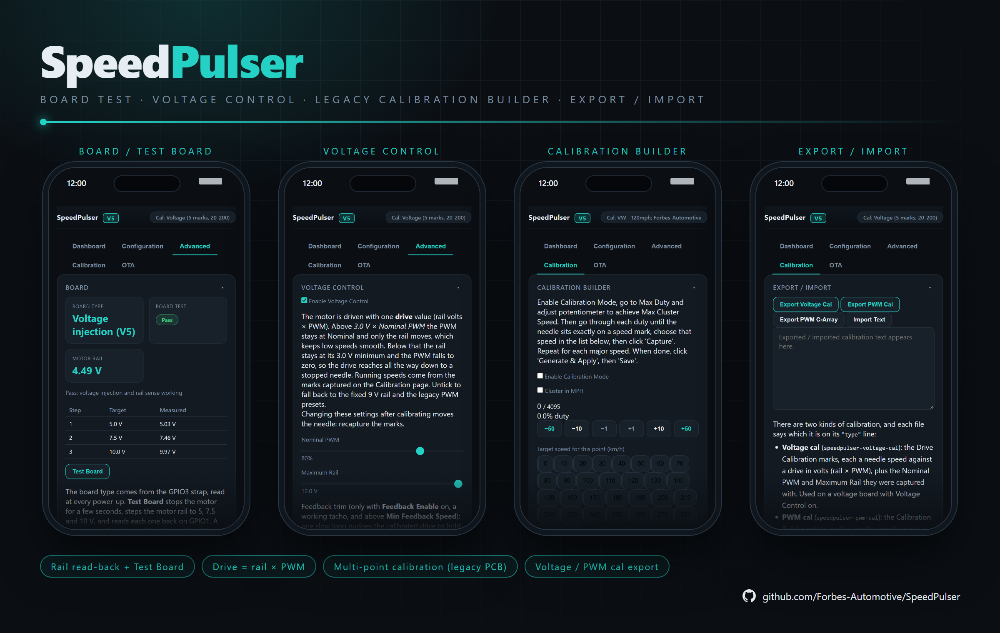
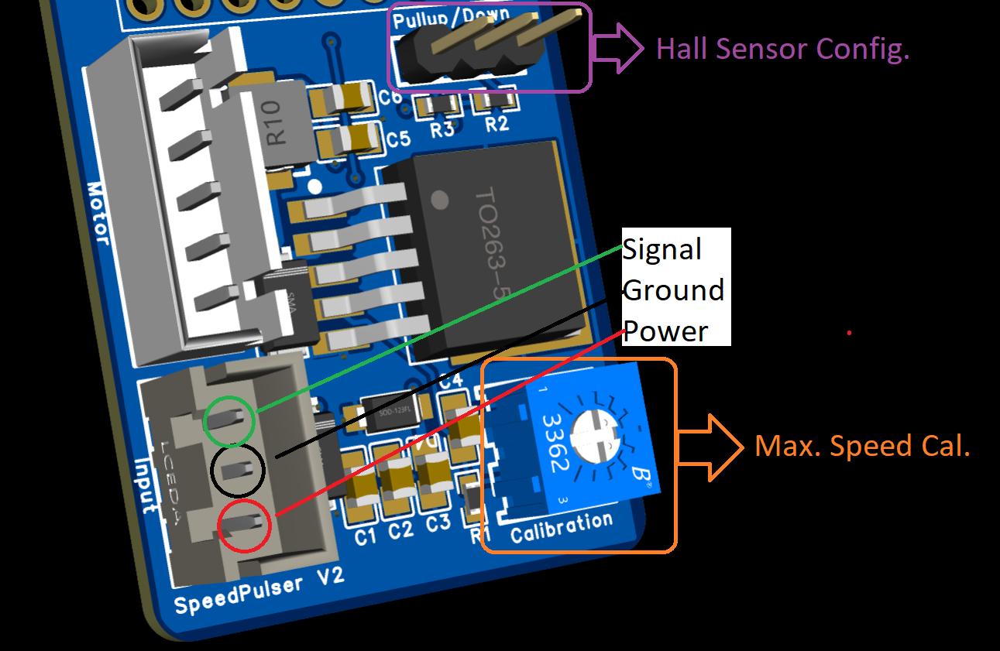
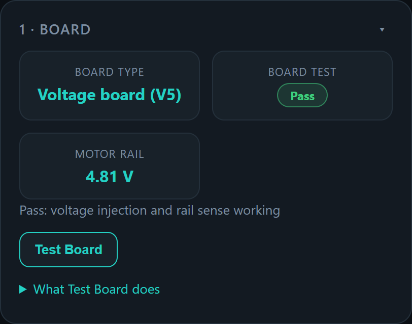
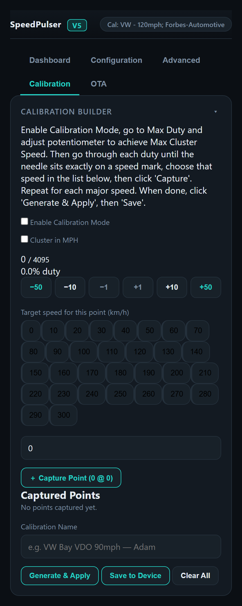
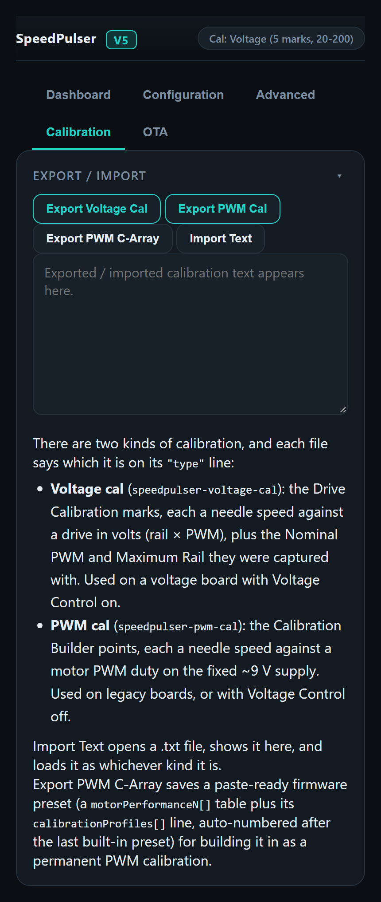
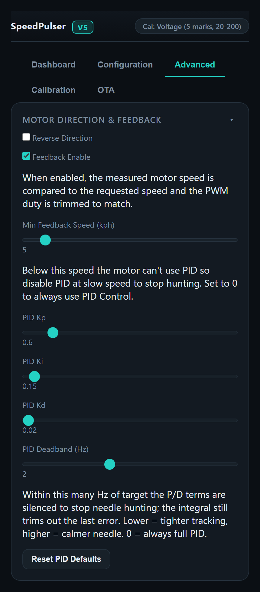

# SpeedPulser

The SpeedPulser brings an OEM analogue speedometer back to life without a mechanical cable. It reads the digital speed pulses from a gearbox hall sensor (or a [Can2Cluster](https://forbes-automotive.com) signal) and drives a small BLDC motor on the back of the speedo with a 10 kHz PWM signal. It is fully open source, set up over WiFi, and calibrated per cluster so the needle reads accurately across the motor's speed range.

It is based on a **LOLIN C3 Mini (ESP32-C3)** and drives a **TY3816B** BLDC motor through a native LEDC hardware PWM channel.


## Contents

- [Features](#features)
- [Supported Clusters](#supported-clusters)
- [Purchase](#purchase)
- [What's in the Box](#whats-in-the-box)
- [Installation](#installation)
  - [Installation Video](#installation-video)
  - [Wiring](#wiring)
  - [Fitting the Drive Shaft](#fitting-the-drive-shaft)
  - [Fitting to the Cluster](#fitting-to-the-cluster)
- [Setup (WiFi & Web Interface)](#setup-wifi--web-interface)
- [Calibration](#calibration)
- [Over-the-Air Updates](#over-the-air-updates)
- [Feedback](#feedback-voltage-board)
- [How Calibration Works](#how-calibration-works)
- [Power Management](#power-management)
- [Technical Reference](#technical-reference)
- [Building & Flashing](#building--flashing)
- [Version History](#version-history)

---

## Features

| Feature | Detail |
|---|---|
| Speed input | 5 V / 12 V square wave (hall sensor or Can2Cluster); any sensor, set by pulses per km, timed pulse by pulse with a glitch filter |
| Motor output | 10 kHz hardware PWM, 12-bit resolution |
| One firmware, every board | A strap on GPIO3 is read at power-up: V4 / V5 boards get voltage control, older PWM-only boards run exactly as before |
| Voltage control *(V4 / V5 PCB)* | One **drive** value (motor rail volts × PWM) runs the motor, so even the slowest speeds are reachable |
| Drive calibration *(V5 PCB)* | Capture the top mark by eye, Auto Fill measures the rest from the motor feedback (up to 20 marks, with Restore Previous); running speeds are interpolated between them |
| Board test *(V5 PCB)* | Motor-rail read-back on GPIO1; **Test Board** steps the rail to 5 / 7.5 / 10 V and checks each one |
| Closed-loop feedback *(V5 PCB)* | One slow trim on the calibrated drive holds the motor speed measured for each mark |
| Calibration profiles | 18 built-in (VW, Ford, Fiat, Merc, Smiths, Opel, VW Bay) |
| Custom calibration | Calibration Builder (legacy boards): capture, generate, save, export / import |
| Calibration curve | Live duty-vs-speed curve with the current operating point on the Dashboard |
| Diagnostics | Live sensor Hz / km/h, needle target, drive, rail, motor feedback and trim; Test Board steps; start-up log |
| WiFi UI | Web-app style interface |
| Needle sweep | Configurable at power-up |
| Speed offset | Global fixed offset **or** 5-point speed-dependent curve |
| OTA updates | Update from GitHub or by file upload on the OTA tab (car stopped); Home WiFi bridge mode; recovery page if the web UI is ever lost |
| Power management | WiFi off and CPU scaled down after 1 min idle |
| Remembers settings | All settings stored in ESP32 Preferences (NVS) |




---

## Supported Clusters

| Cluster | Range | Calibration by |
|---|---|---|
| VW MK1 / MK2 Golf | 120 mph | Martin Springell |
| VW MK1 / MK2 Golf | 120 mph | Forbes Automotive |
| VW MK1 / MK2 Golf | 120 mph | Tara |
| VW MK1 / MK2 Golf | 140 mph | Forbes Automotive |
| VW MK1 / MK2 Golf | 160 mph | Forbes Automotive |
| VW MK1 / MK2 Golf | 300 kph (1.8T) | Forbes Automotive |
| VW Bay VDO | 90 mph | Community |
| Ford Escort | 120 mph (var. 1) | Forbes Automotive |
| Ford Escort | 120 mph (var. 2 — Darren) | Community |
| FIAT Uno | 40–160 mph | Forbes Automotive |
| FIAT Uno | 20–110 mph | Forbes Automotive |
| Mercedes W123 | 120 mph | Forbes Automotive |
| Smiths 5/8" | 70 mph | Forbes Automotive |
| Smiths 5/8" | 90 mph | Forbes Automotive |
| Smiths 5/8" | 150 mph | Forbes Automotive |
| Opel Manta A-72 | 200 km/h | Forbes Automotive |

These are the built-in presets for legacy (PWM-only) boards. On a V5 board you calibrate your own cluster with [Drive Calibration](#drive-calibration-voltage-board).

> New models, calibrations and corrections are very welcome: send them in via GitHub or Discord.

---

## Purchase

Pre-assembled SpeedPulser units are available here: [SpeedPulser — Forbes Automotive](https://forbes-automotive.com/products/speedpulser)

---

## What's in the Box


| Part | Notes |
|---|---|
| Control box | The V5 PCB in a printed lid and base, held by one M3 screw at the lug |
| Motor in its speedo housing | Coupler pre-fitted to the motor shaft; the motor is held in the housing by 3 screws |
| Brass drive shaft | Square brass rod. **Not fitted when shipped.** Supplied long: trim to suit your cluster |
| Securing pins | Two, for housings that have the cross holes in the flange |
| Spare coupler | Couplers are 3D printed |

**The motor** is a TY3816B 12 V outrunner BLDC motor with its own driver board on the back: 37.4 mm can, 6 mm D shaft. The leads on the motor itself are red (+), white (FG, motor feedback), yellow (direction), black (GND) and blue (PWM).

The PDF Installation Guide on GitHub has full step-by-step fitting instructions as well.

---

## Installation

### Installation Video

[](/Images/installation-video.mp4)

About a minute, start to finish: stripping the motor out of its housing (the drive pin isn't fitted when shipped), fitting and lining up the pin, refitting the motor, securing it on the cluster, then setup and calibration.

### Wiring



**Input** — the three-pin connector on the bottom edge of the PCB takes 12 V power and the speed signal:

| Pin | Signal | Notes |
|-----|--------|-------|
| 1 | PWR_IN (12 V) | Black — closest to the board edge; connect to ignition-switched 12 V |
| 2 | GND | White — common ground |
| 3 | Speed Signal | Red — 5 V or 12 V square wave from a hall sensor or Can2Cluster |

> **Pull-up / pull-down jumper:** different hall sensors need either a pull-up or a pull-down resistor, selected with the 2-way jumper header on the PCB. If the SpeedPulser isn't seeing any pulses, swap the jumper position. Sensors with their own internal resistor can run with the jumper removed.

**Motor** — the five-pin connector on the top edge of the PCB:

| Pin | Signal | Notes |
|-----|--------|-------|
| 1 | Motor Power | Black — V4 / V5: the motor rail the firmware sets (Minimum to Maximum rail, up to 12 V); legacy: 5–9 V set via the on-board trimmer |
| 2 | Motor Feedback | White — the motor's feedback (FG) pulse; read on GPIO 4 for the feedback trim (V5 PCB) |
| 3 | Motor Direction | Green — LOW (normal); enable Reverse to flip needle direction — HIGH (reversed) |
| 4 | Motor Ground | White — motor ground |
| 5 | Motor PWM | 10 kHz PWM from ESP32 (via NPN level-shifter to 4V) |

> **Legacy (V3) PCB:** an on-board adjustable **LM2596S** buck converter steps the 12 V supply down to about 9 V for the motor, keeping its operating range and torque within spec across the whole dial; the trimmer sets the motor voltage. V4 / V5 boards set the motor rail themselves (see [Motor Voltage](#feedback-voltage-board)).

### Fitting the Drive Shaft

The drive shaft is not fitted when the unit ships, so the motor comes out of its housing once:


1. Undo the 3 screws and slide the motor out of the speedo housing.
2. Push the brass drive shaft into the square in the coupler, lined up straight. It's a tight fit: a few light taps will seat it.
3. Spin the motor by hand: the shaft must run true. Couplers are 3D printed, so slight misalignment is normal; gentle heat (≤ 100 °C) on the coupler lets you straighten it. If vibration ever loosens the coupler, a drop of superglue fixes it for good. Make sure it runs true before the glue sets.
4. Refit the motor with its wires out through the slot in the housing, and refit the 3 screws.
5. Check the shaft length against the cluster: it must engage the speedo drive but not bottom out and stop the housing seating fully. Trim it to suit, typically flush with the nose of the housing.
6. Push the housing straight on to the cluster's speedo spigot until it seats against the speedo plate, turning it slightly if the shaft needs to find the square in the speedo drive. Where your housing has them, push the two securing pins through the cross holes in its flange: they sit either side of the spigot and lock into its groove.

A spare coupler is in the box.

### Fitting to the Cluster

Once the housing is on the cluster, check:

- the drive shaft engages cleanly
- the motor spins freely by hand
- the housing seats fully

Take your time here: good fitment keeps noise down and makes the coupler last.

> Every motor / housing / cluster pairing wears in slightly differently. **Legacy board:** expect to revisit the on-board potentiometer once after a few hours of running so the top end still reaches full scale cleanly. **V5 board:** check the top of the dial with Speed Test and re-capture the top mark if needed.

---

## Setup (WiFi & Web Interface)

Connect to the **`SpeedPulser`** WiFi access point (open network) and open **`192.168.1.1`** or **`speedpulser.local`** in a browser.

The interface is a single-page app served from the ESP32's LittleFS partition, in Forbes Automotive's dark theme. Settings apply straight away and are saved every 2 seconds. Every value shown is the one the unit actually kept: a value it limits or refuses snaps back. The header shows the firmware version, what the unit is doing (**Running / Speed Test / Calibration Mode**) and what drives the needle (**Cal:**). Current firmware version: **5.09**.

Five tabs, in the order a unit is set up:

| Tab | What's on it |
|---|---|
| **Dashboard** | Live sensor speed (km/h), needle target (dial units), motor speed (voltage board), motor drive or duty, and a chart: the live control trace (voltage board) or the active calibration curve (legacy board) |
| **Setup** | Six numbered cards, top to bottom: **1 Board** (type; Test Board on a voltage board), **2 Cluster & Speed Sensor**, **3 Calibrate**, **4 Check with Speed Test**, **5 Fine-tune** (speed offset), **6 Needle Sweep** |
| **Advanced** | Feedback and Motor Voltage (voltage board), Export / Import, Display Options (dial gauges, per browser) |
| **Diagnostics** | Live values (sensor Hz and km/h, offset, needle target, motor duty, drive, rail, motor feedback, trim), the Test Board steps, the Start-up Log |
| **OTA** | Firmware and web UI updates (see [Over-the-Air Updates](#over-the-air-updates)) |

Cards open and close by tapping their heading, and remember that per browser. Board-specific cards only show on the board they belong to.

<p align="center">
  
  
</p>

### Setup, step by step

**1 · Board** — the board type, read from the GPIO3 strap at power-up. On a **voltage board** run **Test Board** once (12 V+ supply): it stops the motor, steps the rail to 5, 7.5 and 10 V and reads each back. That proves the voltage injection and the rail sense, and stores this board's own voltage line.

**2 · Cluster & Speed Sensor**

| Setting | What it does |
|---|---|
| The dial reads mph | The sensor speed (km/h) is converted to mph for the needle. Drive marks are captured in the dial's unit, so changing it on a calibrated voltage board asks first |
| Speed sensor / Pulses per km | How many pulses the sensor gives per km. VW / Audi gearbox senders: **3600** (1 Hz = 1 km/h). 4,000 / 8,000 / 16,000 pulses-per-mile sensors are in the list; anything else: pulses per mile ÷ 1.609. The card shows the Hz this means at 100 km/h and at Maximum speed |
| Maximum speed (km/h) | The fastest the needle is ever driven; a faster input holds here |
| Smoothing (ms) | The speed is averaged over at least this long: longer = steadier, shorter = quicker. Default 200 ms |
| Reverse motor direction | Flips the motor (GPIO10 HIGH). Only changes with the motor stopped. From V5.01, unticked is normal on every board |

**3 · Calibrate** — *voltage board*: **Drive Calibration** with **Auto Fill** (see [Calibration](#calibration)). *Legacy board*: pick the cluster **preset**, or build your own with the **Calibration Builder** and pick **★ Custom**.

**4 · Check with Speed Test** — the needle follows the slider (km/h, through the same offset and mph conversion as the sensor) instead of the sensor; the card shows the needle target. Speed Test and Calibration Mode can't both be on: switching one on switches the other off. Speed Test is never saved, so the unit always starts in normal running.

**5 · Fine-tune (Speed Offset)** — a fixed offset (−50…+50 km/h), or a different offset at 25 / 75 / 125 / 175 / 225 km/h (±20 each) with straight lines between them, so the needle never jumps as the speed changes. Applied while moving only.

**6 · Needle Sweep** — sweep at power-up, its pace (ms per dial km/h or mph), and a Test Sweep button (only with the car stopped). The sweep moves the needle evenly from the lowest to the highest calibrated speed. It ramps the speed, not the drive, and looks up the drive for each step through the calibration, so the motor's uneven response doesn't show. It slows to a stop at the top, waits there until the motor has arrived (motor feedback) or 0.4 s (no feedback), and comes back the same way. No calibration, no sweep.

<p align="center">
  
  
</p>

---

## Calibration

### Drive Calibration *(voltage board)*

1. Tick **Calibration Mode**. The motor starts stopped.
2. Raise the **Drive** (the −0.5 … +0.5 buttons; the bar under them only shows the drive, and the unit raises it at most 0.5 V per press) until the needle sits exactly on your **top mark** — the highest speed the needle should ever show (nothing runs past it). Wait for **Steady**, type the speed and press **Capture Mark**. A low mark by eye too (e.g. 40) makes the low end closer.
3. Press **Auto Fill** (needs the motor feedback). The motor works through the dial on its own, lowest speed first, in 1-2 minutes. It keeps every eye mark's speed and feedback Hz, re-measures its drive, and adds **auto** marks (10, 20, 30, 40, then every 10 to the top mark, wider if the 20 marks run out) on the straight line through the eye marks, finding the drive that holds each mark's feedback Hz. It never runs faster than the top mark or with more drive than 1.25 × the top mark's, and stops the motor if anything looks wrong. At the start the auto marks are cleared and each new mark appears in the table as it is measured. Stopping it (or a failure) puts the old table back, and after a run **Restore Previous** swaps back (and again). A mark that wasn't really set by eye (tables from before V5.05 load with every mark as eye) can be switched by tapping its eye / auto pill.
4. Check with Speed Test. If a speed is off, put the needle on it and capture it: a mark set by eye always wins and replaces the auto marks that disagree with it.

Until the first mark is captured the motor doesn't move outside Calibration Mode (V5.06: the old uncalibrated guess drove a new speedo past the top of its dial). Marks can only be changed, cleared, restored or imported in Calibration Mode, so nothing jumps the needle while driving.

Why so few eye marks are needed: the dial (feedback Hz → needle) is a straight line only a person can see, while the motor (drive → Hz) bends at the bottom but the motor feedback measures it. On the bench, ten marks captured by eye, 40-193 km/h, all sat within 0.9 km/h of one line.

<p align="center">
  
  
</p>

### Calibration Builder *(legacy board)*

1. Tick **Calibration Mode**, go to maximum duty (the −50 jumps from 0 straight to 4095) and set the pot so the needle reads the cluster's top speed.
2. Step the duty with −50 … +50 until the needle sits on a speed mark, pick that speed and press **Capture**. A point whose duty doesn't rise with its speed is refused (between such points the duty would run the wrong way).
3. Repeat across the dial, name it and press **Save & Use**: the points are saved and it runs as **★ Custom** in the preset list. Builder changes need Calibration Mode and never touch the running preset unless ★ Custom is the one selected.

<p align="center">
  
</p>

### Export / Import *(Advanced tab)*

**Export Calibration** saves the drive marks (voltage board, with the drive settings they were captured with) or the Calibration Builder points (legacy board). **Export as Firmware Preset** writes a paste-ready `motorPerformanceN[]` table. Each file says which kind it is, and **Import File** loads whichever kind it is. The whole file is checked first, and nothing changes if it doesn't fit.

<p align="center">
  
</p>

---

## Over-the-Air Updates

Everything happens on the **OTA** tab, only with the car stopped (an update restarts the unit). USB is only needed for the very first install, or if the web interface is ever lost.

- **Update from GitHub** — press **Check for updates**. The page reads the release list from [`Forbes-Automotive/speedPulser`](https://github.com/Forbes-Automotive/speedPulser) (`Releases/releases.json` plus the `V…` folders) and shows *Installed* vs. *Latest* (older and beta releases sit behind a tick-box, for rolling back). It then installs the selected version in six tracked steps: download the web UI and the firmware, flash the web UI, verify it, flash the firmware, reboot. Nothing is flashed until both files are in. The browser needs internet *while it can still reach the controller*: join the controller to your router in the **Home WiFi (Bridge Mode)** card, put the phone on the same network and open the address the card shows (`http://speedpulser.local/` works there too). On the controller's own access point alone, most phones drop mobile data.
- **Home WiFi (Bridge Mode)** — the controller joins a home or garage network as a station alongside its own access point. Scan or type the network name, save, and once it shows *Connected* the controller is reachable from that network as well. It tries hard for 20 s after boot, then once every 5 minutes, so a saved network can't disturb the access point when the car is parked away from home.
- **Update from Files** — no internet needed: download `littlefs.bin` and `firmware.bin` from the newest `Releases/V…/` folder and upload them here, **Filesystem** (web UI) first, then **Firmware**. The device reboots after the firmware.

Every upload is size-checked, and a filesystem image is verified by mounting it before the device reports success; a failed filesystem upload is wiped rather than left half-written. If the web interface is ever missing (a filesystem update that stopped part-way), the controller serves a **recovery page** at its address with the same two uploads and partition diagnostics, so it is never a USB job. Web assets are served `no-cache`, so a new UI is never hidden behind a stale copy in the phone's browser. `GET /api/ota/info` reports the firmware and web UI versions shown at the top of the tab; `GET /api/ota/check` gates updates on the device being in a safe state.

<p align="center">
  
</p>

---

## Feedback *(voltage board)*

With **Hold the calibrated motor speed** on (Advanced → Feedback), one slow loop nudges the calibrated drive to hold the motor speed captured for each mark, against load and temperature drift. It works above **Off below** (dial units) and outside the **Deadband**, and can never move the drive more than **Trim limit**, nor more than 5 % past the top mark; **Trim gain** sets how quickly it acts. The trim compares the measured motor speed with where the motor *should* be by now (a new target is followed with the motor's own ~0.35 s lag), so a speed change is left to the calibration and doesn't overshoot. Bench-tuned defaults: on, gain **2.0**, limit **±40 %**, deadband **0.3 Hz**, off below **8**; **Reset Feedback Defaults** loads them. On the bench this held 10-160 km/h within about 1 % and recovered a sudden 27 % slow-down at 20 km/h in about 1.5 s.

Legacy boards have no motor feedback wired, so V5.06 removed the old PID loop (Kp / Ki / Kd) and its settings.

**Motor feedback measurement.** The motor gives 5 feedback (FG) pulses per revolution. The firmware times the pulses and averages whole revolutions (which cancels the uneven pole spacing), with a 1 ms filter for line noise, so the reading holds steady down to the motor's slowest speed (~6 Hz).

**Motor Voltage** (Advanced): the motor is driven with one **drive** value, rail volts × PWM. At the low end the rail holds at **Minimum rail** (default 4.8 V: the motor's driver runs smoothly and restarts reliably from about 4.75 V) and the PWM falls to zero; above Minimum rail × **Nominal PWM** the PWM stays at Nominal and the rail rises, up to **Maximum rail**. They change in Calibration Mode only, and moving them after calibrating moves the needle: run Auto Fill again. Maximum rail defaults to 8 V on a new unit (up to 12 V): raise it if the needle can't reach the top of a fast dial. A voltage board always runs this way (V5.06 removed the "Voltage Control off" fixed-rail mode).

<p align="center">
  
  
  
</p>

---

## How Calibration Works

### The Speed Input

```
Speed sensor pulse (GPIO5, falling edge)
    │
    ▼  speedInputPulse()  — interrupt
    Keeps the time of the last 64 pulses. A pulse closer to the last one than half a
    period at Maximum speed is noise (ignition EMI) and is dropped.
    │
    ▼  every 100 ms (control task)
    frequency = pulses ÷ time, over at least the Smoothing time (or the 64 pulses).
    No pulse for a while: the reading falls smoothly (it can't be faster than 1.5 ÷
    time since the last pulse); 0 after 1.5 s.
    speed (km/h) = Hz × 3600 ÷ pulses per km, held at Maximum speed
    │
    ▼  toNeedleTarget()
    + offset (global, or the 5-point curve, interpolated) → × 0.621371 if the dial
    reads mph → rounded once → needle target (dial units)
    │
    ▼  voltage board: drive calibration (+ feedback trim) → rail + PWM
       legacy board:  preset / custom table → 12-bit PWM duty (GPIO2, 10 kHz)
```

A faster sensor just needs its pulses per km: the glitch filter follows it (e.g. 16,000 pulses per mile is ~550 Hz at 200 km/h, filter 0.9 ms). Settings from older firmware carry over: the old Max Hall Frequency / Max Speed pair becomes pulses per km = 3600 × Hz ÷ km/h.

### The Legacy Calibration Array

Each preset is a **385-entry `uint16_t` array** in flash (`PROGMEM`): the **index** is a 10-bit PWM duty (0–384) and the **value** is the speed the needle shows at that duty. Leading values are `0` (the motor's dead band). `findClosestMatch()` finds the duty whose speed is nearest the target; the firmware then interpolates towards the neighbouring entry for a 12-bit duty.

---

## Power Management

The firmware includes a **universal reduced-power code block** (`power_manager`, also used in SpeedPulser Pro, Can2Cluster and other projects) that kicks in 1 minute after the last WiFi client disconnects. This cuts the current through the on-board linear regulator, directly reducing its heat — important for long ignition-on times.

**What changes when idle:**

| Action | Saving |
|---|---|
| WiFi radio off | ~80–120 mA average (single biggest saving) |
| CPU: 160 MHz → 80 MHz | Moderate reduction in active current |
| Bluetooth controller released at boot | ~60 KB RAM freed; small idle current saving |
| WiFi modem-sleep while clients are connected | Minor saving without losing connectivity |
| Reduced WiFi TX power | Adequate for in-car range; further small saving |

**Waking back up:** as soon as a device reconnects to the WiFi AP, full power comes back automatically: the radio comes up, the CPU returns to 160 MHz and the web server resumes. A power cycle (ignition off / on) also restores WiFi.

> The LOLIN C3 Mini's maximum CPU frequency is 160 MHz; the power manager detects this at compile time and adjusts.

---

## Technical Reference

### Pin Assignments (LOLIN C3 Mini)

| GPIO | Function |
|---|---|
| 1 | Motor rail read-back, V_MOT_SENSE (V5 PCB; 39k / 10k divider) |
| 2 | Motor PWM output (LEDC 12-bit, stepped to 5 V via NPN transistor) |
| 3 | Board strap, read at power-up (1k to GND = voltage board, open = legacy PWM-only board) |
| 4 | Motor feedback (FG) input (voltage board; falling-edge interrupt, timed pulse by pulse) |
| 5 | Speed pulse input (falling-edge interrupt) |
| 6 | V_ADJ: PWM "DAC" into the motor buck converter's feedback (V4 / V5 PCB; higher V_ADJ = lower rail) |
| 7 | EN_ADJ: motor buck converter enable (V4 / V5 PCB) |
| 8 | Onboard LED (blinks to confirm incoming pulses) |
| 10 | Motor direction (LOW = normal, HIGH = reversed) |

### PWM Parameters

| Parameter | Value |
|---|---|
| Frequency | 10 kHz |
| Resolution | 12-bit (0–4095) |
| Driver | Native ESP-IDF `ledc_set_duty` / `ledc_update_duty` |

> Built-in calibration tables were captured at 10-bit and are scaled up to the 12-bit hardware domain automatically; the Calibration Builder captures new points at full 12-bit resolution.

### FreeRTOS Tasks

| Task | Core | Period |
|---|---|---|
| `speedControl` | 0 | 100 ms (speed input, motor, motor feedback, Auto Fill) |
| `settingsSave` | 0 | 2 000 ms (NVS only writes values that changed) |
| `powerManagerTask` | 0 | 5 000 ms check interval |

### PlatformIO Dependencies

| Library | Purpose |
|---|---|
| `mathieucarbou/ESPAsyncWebServer` | Async web server (ESP-IDF 5.x compatible fork) |
| `mathieucarbou/AsyncTCP` | Underlying TCP for AsyncWebServer |
| `bblanchon/ArduinoJson` | JSON serialisation for REST API |

Platform: `pioarduino/platform-espressif32` (Arduino-ESP32 3.x / ESP-IDF 5.x)

---

## Building & Flashing

1. Open the project folder in VS Code with the PlatformIO extension installed.
2. Confirm `env:lolin_c3_mini` is selected in `platformio.ini`.
3. **Build Filesystem Image** (PlatformIO sidebar) — packages the web UI files from `data/` into a LittleFS image.
4. **Upload Filesystem Image** — flashes the web UI to the LittleFS partition.
5. **Build & Upload** — flashes the main firmware.
6. Open the Serial Monitor at 115 200 baud to confirm the start-up messages.

> Serial debug output is controlled by `-D enableDebug` in `platformio.ini` (0 for releases; 1 adds tagged debug output and a 2 s wait for a USB host at boot).

---

## Version History

| Version | Summary |
|---|---|
| V1.01 | Initial release |
| V1.05 | Global speed offset |
| V1.06 | Pulse timeout / reset-to-zero |
| V1.07 | 160 mph MK2 Golf calibration (Charlie) |
| V1.09 | Martin Springell MK1 Golf calibration |
| V1.11 | WiFi settings page |
| V1.12 | Mercedes W123 calibration |
| V1.13 | Calibration selection in WiFi |
| V1.15 | Calibration test mode via WiFi |
| V1.17 | Smiths 70 mph calibration |
| V1.18 | Over-the-Air updates |
| V1.19 | Smiths 90 mph calibration |
| V2.00 | Ported to PlatformIO |
| V2.10 | LEDC hardware PWM; FreeRTOS tasks; new REST API tabbed web UI; power management module |
| V2.20 | "Cluster in MPH" conversion option |
| V2.21 | Fixed LEDC driver for Arduino-ESP32 3.x (`ledc_set_duty` / `ledc_update_duty`) |
| V3.00 | PCB revision to include Motor Feedback + Reverse option and two Buck Converters (one for the motor, one for the ESP32) |
| V3.01 | PID Calibration, Calibration Builder + Calibration Curve |
| V3.02 | Smoother needle sweep |
| V3.0x | Various multiple tweaks |
| V3.10 | Tighter PID control, feedback check for legacy PCBs etc |
| V4.00 | Hardware voltage control (V4 PCB): one firmware for legacy and V4 boards, auto-detected from the GPIO3 strap |
| V4.01 | Shared Forbes Automotive UI theme; common WiFi and OTA modules |
| V4.02 | OTA overhaul: update from GitHub, Home WiFi bridge mode, recovery page |
| V5.00 | V5 PCB: motor-rail read-back, Test Board, top-speed calibration by rail voltage |
| V5.01 | Drive calibration (up to 10 marks, slowest speeds reachable), one slow feedback trim, Reverse Direction corrected (unticked = normal; resets on update), voltage cal export / import, long press on a phone no longer highlights text |
| V5.02 | Start-up log on the Advanced page: reset reason per start (power-on / brown-out / crash / watchdog), short-run counter for supplies that drop out while cranking |
| V5.03 | Calibration drive changed with the buttons only (the slider just shows it); firmware caps each drive increase at 0.5 V |
| V5.04 | Motor feedback read from pulse timing (no more 0 Hz dropouts below ~20 Hz), Minimum Rail setting (default 4.8 V) for smooth, reliable low speeds, feedback trim that doesn't overshoot on speed changes, bench-tuned feedback defaults (on by default on voltage boards) |
| V5.05 | Drive Calibration **Auto Fill**: capture the top mark by eye (plus a low one if you like) and the firmware measures the rest from the motor feedback; eye / auto marks, up to 20 marks, Restore Previous |
| V5.06 | Audit pass: speed sensor set by **pulses per km** (any sensor; glitch filter follows it), speed averaged pulse by pulse (no more block median), offset curve interpolated, mph rounded; uncalibrated voltage board no longer drives the needle; Calibration Builder refuses out-of-order points; settings range-checked, saved during Speed Test, calibration tables saved safely; no table or direction changes while driving; OTA only with the car stopped; "Voltage Control off" and the legacy PID removed; web UI reorganised into Setup steps |
| V5.07 | Even needle sweep: ramps the speed through the calibration instead of the drive / duty, slows to a stop at the top and waits for the motor; legacy boards sweep to the top of their table instead of full PWM |
| V5.08 | Second audit pass: Calibration Builder no longer overwrites the running preset, Save & Use always saves; Auto Fill clears and rebuilds the table on screen (stop = old table back), eye / auto switchable; Motor Voltage in Calibration Mode only, Maximum Rail default 8 V; test modes end when WiFi sleeps; the feedback trim drops out when the motor feedback is lost; rail over-voltage trip; OTA / WiFi cross-site check; orange test banner, slider scroll guard, offline badge, tidier UI |
| V5.09 | One web page (app.js) shared with SpeedPulser Pro, same setting names in both; tuning constants in `speedPulser_defs.h`; small audit fixes: no needle twitch after 71 min parked, slow sensors don't flicker to 0, drive tables range-checked and saved power-cut safe, Test Board stays under Maximum rail, preset tables back out of RAM, old settings keys cleared, library versions pinned |
