# SpeedPulser: Installation & Assembly Manual

The SpeedPulser brings an analogue speedometer back to life without a mechanical cable. It reads the speed pulses from a gearbox hall sensor (or a Can2Cluster) and spins a small motor on the back of the speedo at exactly the right speed for the needle. This manual takes you from the box to a calibrated, working speedo: what's in the kit, how it goes together, every plug and pin, fitting to the cluster, wiring into the car, setup and calibration.

It covers the **V5 board** with firmware **5.10**. Owners of older (legacy, PWM-only) boards: the fitting and wiring are the same, and [Legacy boards](#legacy-boards-v2-to-v4) covers what differs.

<!-- github-only -->
> [!TIP]
> A print-ready copy of this manual is in this folder: **[SpeedPulser-Installation-Manual.pdf](SpeedPulser-Installation-Manual.pdf)**. The full product README, with every setting explained, is [here](../README.md).
<!-- /github-only -->

## Contents

<!-- toc -->
- [Before You Start](#before-you-start)
  - [What's in the box](#whats-in-the-box)
  - [Tools you'll need](#tools-youll-need)
  - [The order of work](#the-order-of-work)
- [How It Goes Together](#how-it-goes-together)
- [Plugs & Pins](#plugs--pins)
  - [Input plug (3-pin)](#input-plug-3-pin)
  - [Motor plug (5-pin)](#motor-plug-5-pin)
  - [Speed sensor pull-up / pull-down](#speed-sensor-pull-up--pull-down)
  - [Leads and plugs](#leads-and-plugs)
- [Wiring It In](#wiring-it-in)
  - [Good practice](#good-practice)
  - [Connections](#connections)
  - [Hall sensor wiring (VW / Audi)](#hall-sensor-wiring-vw--audi)
- [Fitting the Drive Shaft](#fitting-the-drive-shaft)
- [Fitting to the Cluster](#fitting-to-the-cluster)
- [First Power-Up & Setup](#first-power-up--setup)
  - [Connect to the SpeedPulser](#connect-to-the-speedpulser)
  - [Setup, card by card](#setup-card-by-card)
- [Calibration](#calibration)
  - [Legacy boards (V2 to V4)](#legacy-boards-v2-to-v4)
- [Final Checks](#final-checks)
- [Firmware Updates](#firmware-updates)
- [Troubleshooting](#troubleshooting)
- [Specifications](#specifications)
- [Support](#support)
- [Disclaimer](#disclaimer)
<!-- /toc -->

## Before You Start

### What's in the box

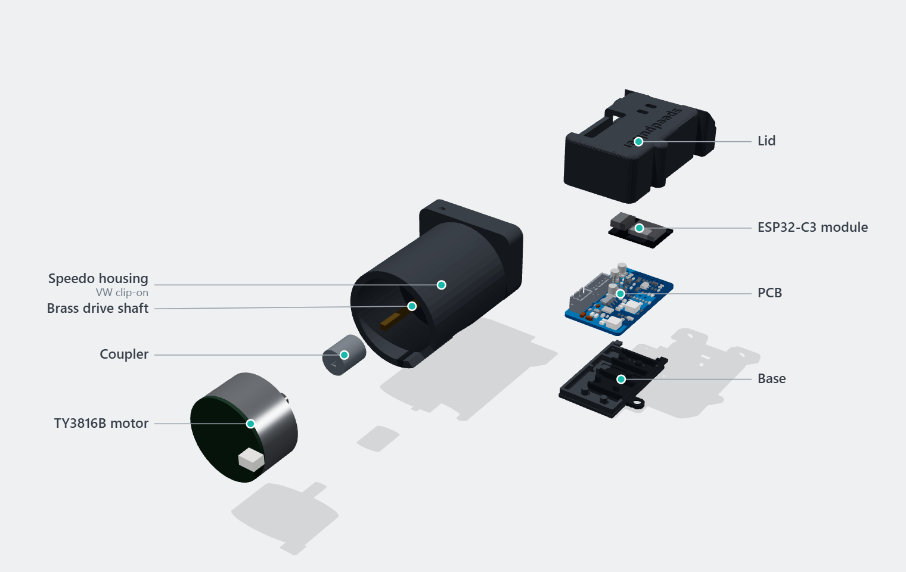

| Part | Notes |
|---|---|
| Control box | The V5 board in a printed lid and base, held together by one M3 screw at the lug |
| Motor in its speedo housing | Coupler already fitted to the motor shaft; the motor is held in the housing by 3 screws |
| Brass drive shaft | Square brass rod. **Not fitted when shipped**, and supplied long: you trim it to suit your cluster |
| Securing pins (2) | For housings that have cross holes in the flange |
| Spare coupler | The couplers are 3D printed, so a spare is included |
| Leads | 3-pin input lead (black +12 V, white ground, red speed) and the 5-pin motor lead |

**The motor** is a TY3816B 12 V outrunner with its own driver board on the back (37.4 mm can, 6 mm D shaft). Its five leads are red (+), white (feedback), yellow (direction), black (ground) and blue (PWM).

### Tools you'll need

- Small Phillips screwdriver (motor housing screws)
- Small hammer or mallet, for tapping the drive shaft home
- Fine-tooth saw or cutters and a file, to trim the drive shaft
- Wire strippers, solder or good crimp splices, heat-shrink, cable ties
- A multimeter (to find ignition 12 V and to check the speed signal)
- A phone or laptop with WiFi, for setup

### The order of work

1. Fit the drive shaft into the motor (bench).
2. Fit the motor housing onto the cluster (bench, cluster out of the car).
3. Run the wiring and plug in.
4. Power up, set up and calibrate over WiFi.
5. Check, then refit the cluster.

You can do the calibration with the cluster on the bench (a 12 V supply and the motor fitted is all it needs) or in the car.

## How It Goes Together

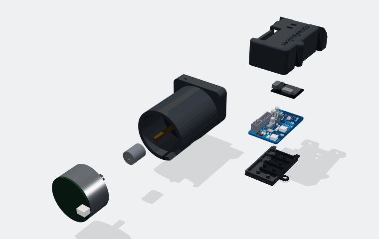

The SpeedPulser is two parts joined by the 5-pin motor lead:

- **The control box** holds the board: an ESP32-C3 module that reads the speed signal, works out the speed, and drives the motor. It also sets the motor's supply voltage (the "rail") and reads back the motor's own speed through its feedback wire, so the needle holds steady across the whole dial.
- **The motor unit** replaces the speedo cable. The motor sits in a printed housing that pushes onto the cluster's speedo spigot; a printed coupler on the motor shaft carries a square brass drive shaft into the speedo's drive, exactly where the cable's inner used to go.

The control box closes with a single M3 screw at the lug. You only need to open it to change the pull-up / pull-down jumper (see [Speed sensor pull-up / pull-down](#speed-sensor-pull-up--pull-down)).

## Plugs & Pins

The board has two plug-in connectors, both **JST XH (2.5 mm pitch)**: a 3-pin **input** plug for the car and a 5-pin **motor** plug.

### Input plug (3-pin)

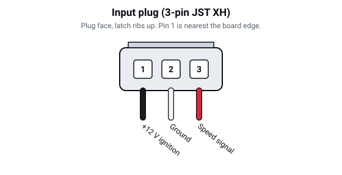

| Pin | Signal | Supplied lead | Connect to |
|---|---|---|---|
| 1 | +12 V | Black | **Ignition-switched** 12 V |
| 2 | Ground | White | Chassis / cluster ground |
| 3 | Speed signal | Red | Hall sensor output, or Can2Cluster speed out (5 V or 12 V square wave) |

> [!WARNING]
> On the supplied input lead **black is +12 V and red is the speed signal**, the opposite of what you'd guess. Go by the pin number, and check with a meter before you power up.

### Motor plug (5-pin)

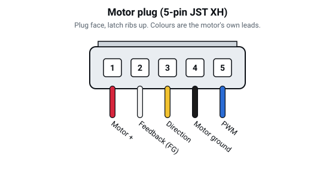

| Pin | Signal | Motor lead | What it does |
|---|---|---|---|
| 1 | Motor + | Red | The motor rail, set by the firmware (4.8 V up to 12 V) |
| 2 | Feedback (FG) | White | 5 pulses per motor revolution, read back for calibration and feedback |
| 3 | Direction | Yellow | Low = normal; **Reverse motor direction** in setup flips it |
| 4 | Motor ground | Black | Motor ground |
| 5 | PWM | Blue | 10 kHz speed signal to the motor's driver |

The motor lead comes made up and plugged in. If it needs to be longer, extend it as below.

### Speed sensor pull-up / pull-down

Hall sensors are open-collector or push-pull, and some need a pull-up resistor on the signal, some a pull-down. The 3-pin jumper header on the board (**Pullup/Down**) picks one:

| Jumper on | Setting | Use for |
|---|---|---|
| Pins 1 and 2 | Pull-up (**default**) | VW / Audi gearbox hall senders, most open-collector sensors |
| Pins 2 and 3 | Pull-down | Sensors that switch to +12 V |
| Removed | None | Sensors with their own resistor, and Can2Cluster |

If the SpeedPulser isn't seeing pulses (the Dashboard shows 0 Hz while the wheels turn), move the jumper to the other position first.

### Leads and plugs

<!-- shared:xh-leads -->
The module's leads plug into the board through small **JST XH (2.5 mm)** connectors. They're polarised, so they only fit one way round: line up the ribs on the plug with the slot in the header and push it fully home.

- **Wire colours on supplied leads can vary between batches.** Always go by the pin number and the board's silkscreen, not by colour alone.
- **Need a longer lead?** Extend it in the middle of the wire: solder and heat-shrink each joint, staggering the joints so they don't sit side by side. Don't cut at the plug.
- **Unplugging:** grip the plug body, not the wires, and ease it out straight.
<!-- /shared:xh-leads -->

## Wiring It In

### Good practice

<!-- shared:wiring-practice -->
- **Disconnect the battery** before you cut into or splice any wiring, and reconnect it last.
- **Fuse the feed.** Take power through a fuse (not needed on the V5 board, which has its own 4 A resettable fuse on the 12 V input; on an older board a 2 A or 3 A fuse is plenty) as close as possible to where you tap into the supply.
- **Use the right supply.** The SpeedPulser wants **ignition-switched 12 V** (live only with the ignition on), e.g. the cluster's own ignition feed.
- **Good grounds.** Use a clean, bare-metal chassis point or the car's own ground at the cluster / ECU. A poor ground is the most common cause of odd readings.
- **Splice properly.** Solder and heat-shrink, or use good-quality crimp splices. Avoid scotch-locks / T-taps: they work loose.
- **Route it safely.** Keep the loom away from ignition HT leads, coils, hot or moving parts, and tie it to existing looms. Use grommets wherever it passes through metal.
- **CAN wires.** Where there are CAN High / CAN Low wires, keep them twisted together as a pair all the way.
<!-- /shared:wiring-practice -->

### Connections

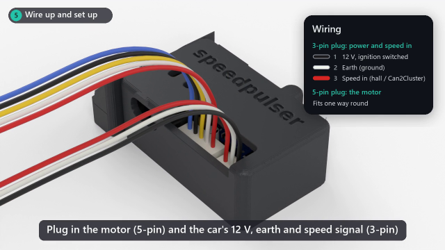

1. **Ground** (input pin 2) to a good chassis ground or the cluster ground.
2. **+12 V** (input pin 1) to an ignition-switched 12 V feed. The V5 board has its own 4 A resettable fuse on the 12 V input, so an inline fuse isn't needed.
3. **Speed signal** (input pin 3) to your speed source:
   - **Gearbox hall sensor:** the sensor's signal wire. The sensor itself also needs power and ground (below).
   - **Can2Cluster:** its speed output. Remove the pull-up / pull-down jumper.
4. Plug the 5-pin motor lead into the board, and the 3-pin input lead.
5. Tidy and secure the loom, keeping the control box somewhere dry and away from heat.

### Hall sensor wiring (VW / Audi)

The gearbox hall sender needs its own power. On most VW / Audi senders the 3-pin plug is:

| Sender pin | Wire to |
|---|---|
| 1 | +12 V (ignition switched, can share the SpeedPulser feed) |
| 2 | Signal: to SpeedPulser input pin 3 |
| 3 | Ground |

Check your own sender before connecting: with the sender powered and the wheels turned slowly by hand, the signal pin should switch between about 0 V and the supply.

VW / Audi senders give **3600 pulses per km** (1 Hz = 1 km/h). Other sensors are set up by their pulses per km (or per mile) in [Setup](#first-power-up--setup).

## Fitting the Drive Shaft

The drive shaft isn't fitted when the unit ships, so the motor comes out of its housing once. Do this on the bench.

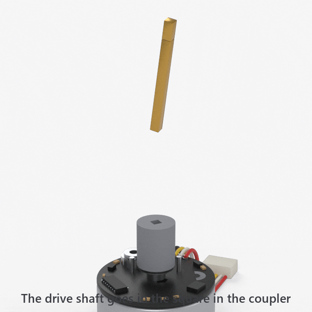

1. **Undo the 3 screws** on the front of the housing.

   
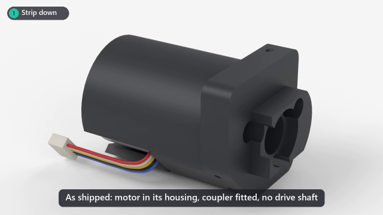 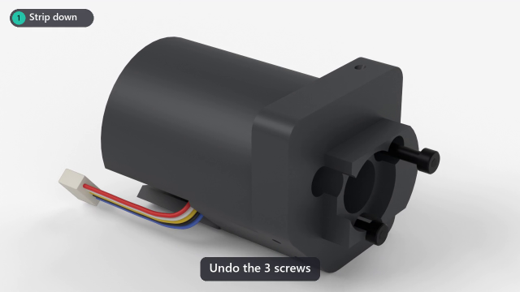

2. **Slide the motor out** of the housing.

   
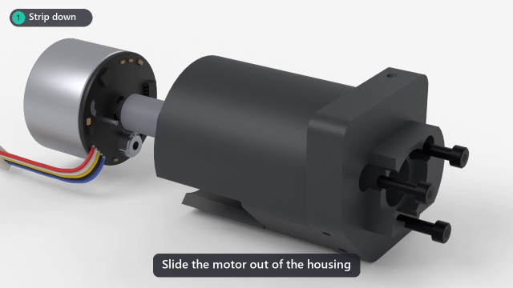

3. **Push the brass drive shaft into the square in the coupler**, lined up straight. It's a tight fit: a few light taps will seat it.

   
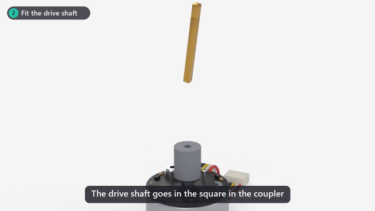 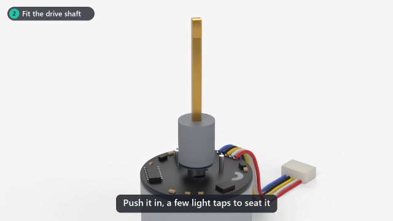

4. **Spin the motor by hand.** The shaft must run true. The couplers are 3D printed, so a little misalignment is normal: gentle heat (no more than 100 °C, e.g. a hair dryer or heat gun on low) softens the coupler enough to straighten it.

   
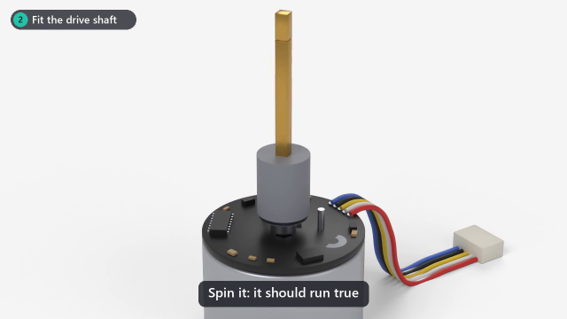

5. **Refit the motor** with its wires out through the slot in the housing, and refit the 3 screws.

   
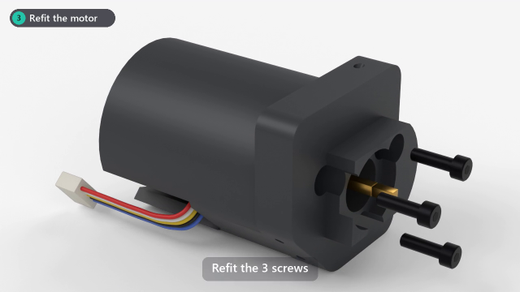

> [!TIP]
> If vibration ever loosens the coupler on the motor shaft, a drop of superglue fixes it for good. Make sure it runs true before the glue sets.

## Fitting to the Cluster

1. **Check the shaft length** against the cluster. It must engage the speedo drive but not bottom out and stop the housing seating fully. It typically finishes flush with the nose of the housing: trim it with a fine saw and file the end square.

   
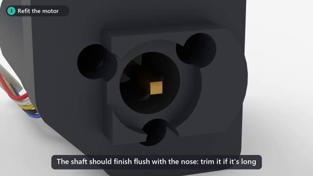

2. **Push the housing straight onto the speedo spigot** until it seats against the speedo plate. Turn it slightly if the shaft needs to find the square in the speedo drive.

   
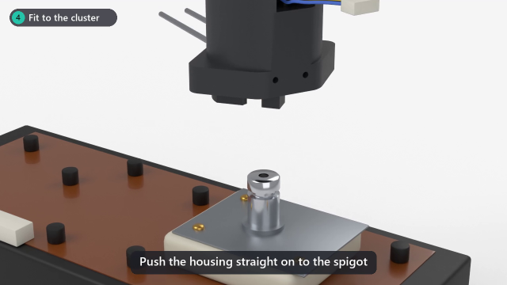

3. **Fit the two securing pins** through the cross holes in the flange, where your housing has them. They sit either side of the spigot and lock into its groove.

   
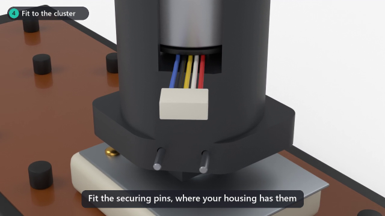

4. **Check the fit:** the shaft engages cleanly, the motor turns freely by hand, and the housing sits fully home. Take your time here: a good fit keeps noise down and makes the coupler last.

## First Power-Up & Setup

### Connect to the SpeedPulser

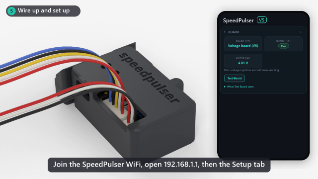

1. Turn the ignition on (or power the bench supply). The onboard LED blinks with each speed pulse it sees.
2. On your phone, join the WiFi network **SpeedPulser** (open, no password).
3. Open **192.168.1.1** (or **speedpulser.local**) in the browser.
4. The header shows the firmware version and what the unit is doing. Go to the **Setup** tab: its six numbered cards are the setup, top to bottom.

Settings take effect straight away and are saved automatically. After a minute with nothing happening the WiFi turns off to save power: turn the ignition off and on again to get it back.

### Setup, card by card

| Card | What to do |
|---|---|
| **1 Board** | Shows the board type. On a V5 board press **Test Board** once (with the 12 V supply connected): it checks the motor supply at 5, 7.5 and 10 V. |
| **2 Cluster & Speed Sensor** | Tick **The dial reads mph** for an mph speedo. Pick your speed sensor (VW / Audi: **3600** pulses per km), set **Maximum speed** to the top of your dial. If the needle turns the wrong way, tick **Reverse motor direction**. |
| **3 Calibrate** | Calibrate the needle to your dial. See [Calibration](#calibration). |
| **4 Check with Speed Test** | Move the slider: the needle follows. Check it against the dial at several speeds. |
| **5 Fine-tune** | A speed offset, fixed or speed-dependent, if the needle reads consistently high or low once you're driving. |
| **6 Needle Sweep** | Optional sweep of the needle at power-up. |

  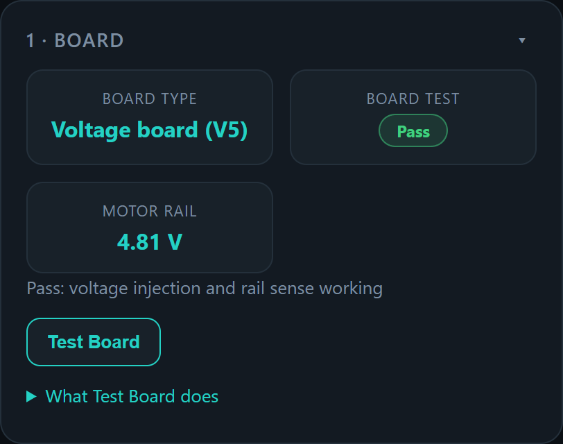
  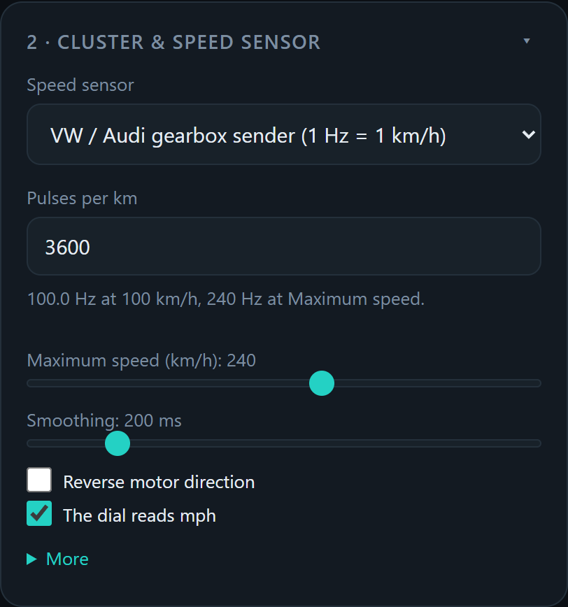

## Calibration

Every cluster, motor and housing is slightly different, so the SpeedPulser is calibrated on your own speedo. You set the top of the dial by eye, then **Auto Fill** measures the rest using the motor's feedback. It takes a couple of minutes.

1. In **Setup → 3 Calibrate**, tick **Calibration Mode**. The motor starts stopped.
2. Raise the **Drive** with the + buttons until the needle sits exactly on your **top mark**, the highest speed the needle should ever show.

   
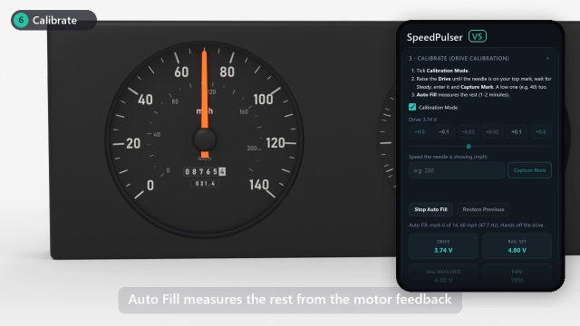

3. Wait for **Steady**, type the speed the needle is showing and press **Capture Mark**. Capturing a low mark by eye too (e.g. 40) makes the low end even closer.
4. Press **Auto Fill**. The motor works through the dial on its own, slowest first, adding marks every 10 up to your top mark. Leave it alone until it finishes (1 to 2 minutes).

   
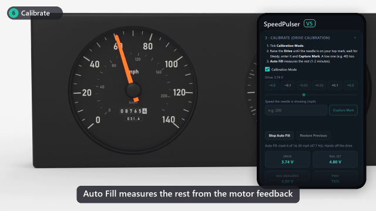

5. **Check with Speed Test** (card 4). If any speed is off, put the needle on it in Calibration Mode and capture it: a mark set by eye always wins.
6. Untick **Calibration Mode**.

  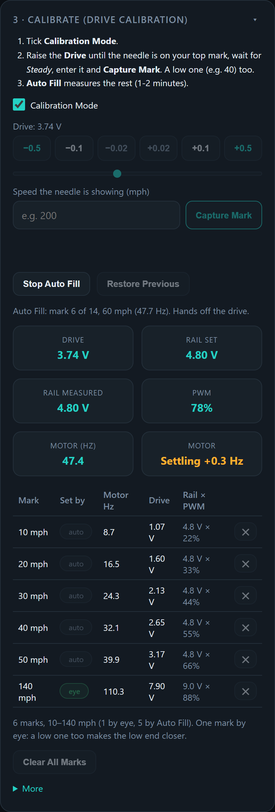
  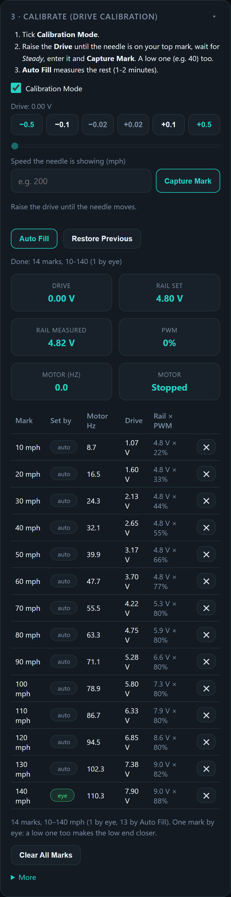

> [!NOTE]
> Until the first mark is captured, the motor doesn't move outside Calibration Mode. This stops an uncalibrated unit over-driving a speedo past the top of its dial.

> [!TIP]
> Back up your calibration: **Advanced → Export / Import → Export Calibration** saves it to your phone. Import it again after a reset, or onto a replacement unit.

<!-- pagebreak -->

### Legacy boards (V2 to V4)

Older boards without voltage control are calibrated differently:

- **V4 board:** same Setup tab, but card 3 offers the built-in **presets** (VW, Ford, Fiat, Mercedes, Smiths, Opel) or the **Calibration Builder**.
- **V2 / V3 board:** the blue **Calibration** trimmer on the board sets the motor voltage. Tick Calibration Mode, go to maximum duty, and turn the trimmer until the needle reads the cluster's top speed. Then pick a preset, or build your own in the Calibration Builder.
- **Fuse:** the resettable fuse is on the V5 board. On an older board, fuse the 12 V feed (2 A or 3 A).

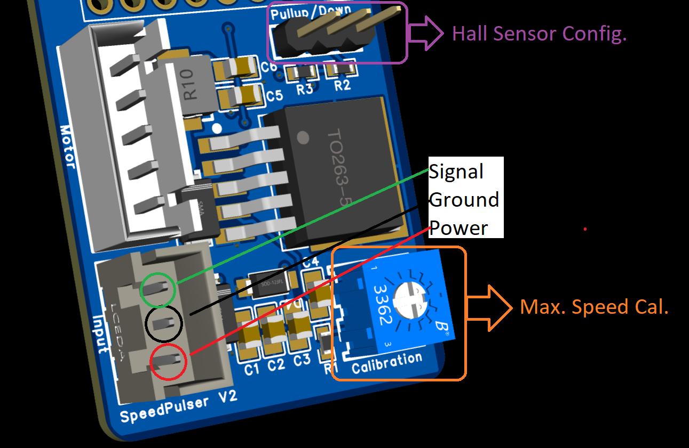

Expect to revisit the trimmer once after a few hours of running as the motor and coupler bed in.

## Final Checks

Before you refit the cluster and put the dash back together:

- [ ] Input plug: +12 V only with the ignition on, ground good, speed signal connected
- [ ] Motor lead plugged in fully at both ends, and routed away from anything hot or moving
- [ ] Drive shaft engaged, housing fully home, securing pins in (where fitted)
- [ ] Needle sweeps and returns to zero cleanly (Setup → 6 → Test Sweep)
- [ ] Speed Test matches the dial at low, middle and top speeds
- [ ] Calibration exported to your phone
- [ ] Out on the road: compare with a GPS speedo app and fine-tune with the speed offset if needed

## Firmware Updates

Updates are done over WiFi from the **OTA** tab, with the car stopped:

- **Update from GitHub:** join the SpeedPulser to your home WiFi in the **Home WiFi (Bridge Mode)** card, put your phone on the same network, open the address the card shows, and press **Check for updates**.
- **Update from Files:** download `littlefs.bin` and `firmware.bin` from the newest `Releases/V…` folder on GitHub and upload them, **Filesystem** first, then **Firmware**.

Your settings and calibration are kept through updates. USB is only needed for a first install, using the [Forbes Automotive Firmware Updater](https://forbes-automotive.com/pages/module-software-updater).

## Troubleshooting

| Symptom | Likely cause | Fix |
|---|---|---|
| No WiFi network | WiFi has turned itself off after a minute idle | Turn the ignition off and on, then join within a minute |
| Needle doesn't move at all | Not calibrated yet | Capture a top mark and run Auto Fill ([Calibration](#calibration)) |
| Dashboard shows 0 Hz while driving | No speed signal, or wrong pull-up / pull-down | Check the signal wire and the sender's power and ground; try the other jumper position; the onboard LED should blink with pulses |
| Needle turns the wrong way | Motor direction | Setup → 2 → **Reverse motor direction** |
| Needle can't reach the top of the dial | Motor rail limit too low | Advanced → Motor Voltage: raise **Maximum rail** (up to 12 V), then run Auto Fill again |
| Needle reads high or low by a fixed amount | Sensor pulses per km, or tyre size | Check card 2; then use card 5 Fine-tune |
| Needle wobbles or is noisy | Shaft not running true, or housing not fully seated | Re-check the coupler (gentle heat to true it), shaft length and seating |
| Speed jumps about or reads when stopped | Electrical noise on the signal | Re-route the signal wire away from HT leads; check grounds |
| Test Board fails | No 12 V at the board, or a board fault | Check the supply under load; get in touch with the result |

## Specifications

| Item | Value |
|---|---|
| Supply | 12 V nominal, ignition switched |
| Protection | 4 A resettable (PTC) fuse on the 12 V input (V5 board) |
| Speed input | 5 V or 12 V square wave; hall sensor or Can2Cluster; pulses per km set in setup |
| Motor output | 10 kHz PWM, 12-bit; motor rail 4.8 to 12 V (V5 board) |
| Motor | TY3816B 12 V BLDC outrunner with feedback (FG, 5 pulses per revolution) |
| Controller | LOLIN C3 Mini (ESP32-C3) |
| Connectors | JST XH 2.5 mm: 3-pin input, 5-pin motor |
| Setup | WiFi access point **SpeedPulser**, 192.168.1.1 / speedpulser.local |
| Power saving | WiFi off and CPU slowed after 1 minute idle |

## Support

<!-- shared:support -->
- **Firmware updates:** over WiFi from the module's **OTA** tab, or by USB from the [Forbes Automotive Firmware Updater](https://forbes-automotive.com/pages/module-software-updater) (Chrome or Edge on a computer).
- **Source code, releases and issues:** [Forbes-Automotive/speedPulser on GitHub](https://github.com/Forbes-Automotive/speedPulser)
- **Shop and contact:** [forbes-automotive.com](https://forbes-automotive.com)

When asking for help, include the firmware version (shown in the web interface header), your car, and a photo of the wiring at the module.
<!-- /shared:support -->

## Disclaimer

<!-- shared:disclaimer -->
Forbes Automotive is not responsible for any damage or loss to your vehicle or its contents during or after fitting the SpeedPulser. By using the product you confirm that you have read and understood this disclaimer and release Forbes Automotive from liability for any such damage or loss.

**Speed readings.** The needle shows the speed measured at the gearbox (or the speed Can2Cluster sends), converted through your calibration. Treat it as approximate: tyre size, wear and calibration all affect it. Forbes Automotive accepts no responsibility for incorrect speed readings or any speed-related incident.

**Limitation of liability.** In no event shall Forbes Automotive be liable for any direct, indirect, incidental, consequential, special or punitive damages arising out of or in connection with the installation or use of the SpeedPulser, whether in contract, tort, strict liability or any other legal theory.

**Off-road use.** This product is intended for off-road and motorsport use only. It is your responsibility to check that your vehicle remains legal and roadworthy where you drive it.

**Warranty.** Forbes Automotive makes no warranties, express or implied, about the product, including any warranties of merchantability or fitness for a particular purpose. Your statutory rights are not affected.

**Open source.** The firmware and web interface are open source. If you change them, you take responsibility for what your changed version does.
<!-- /shared:disclaimer -->
